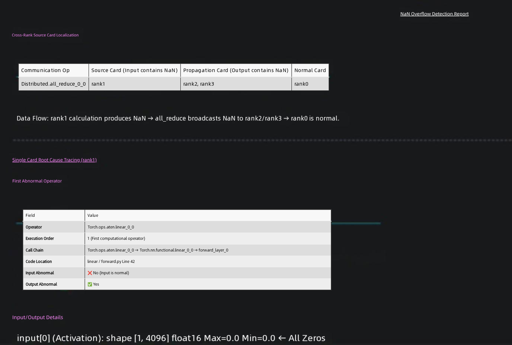
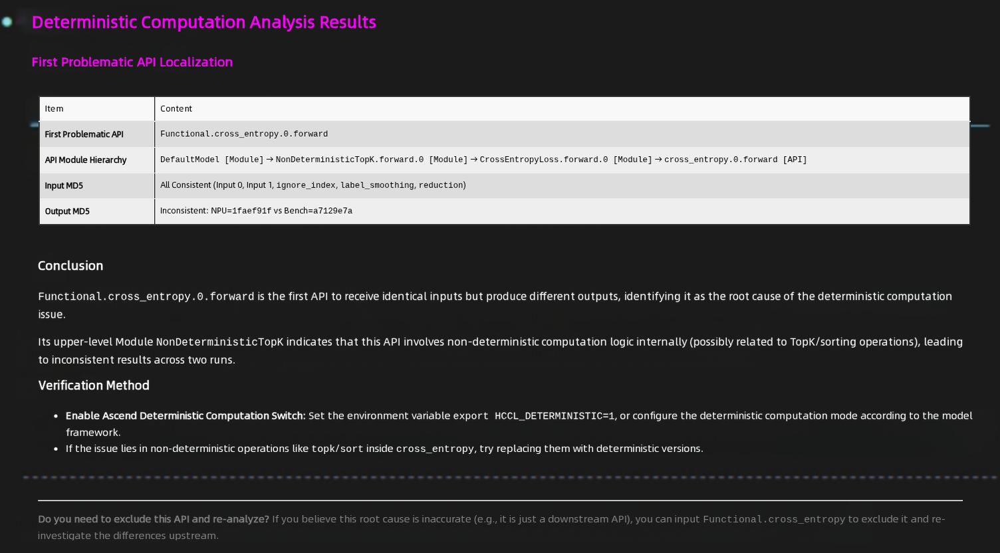
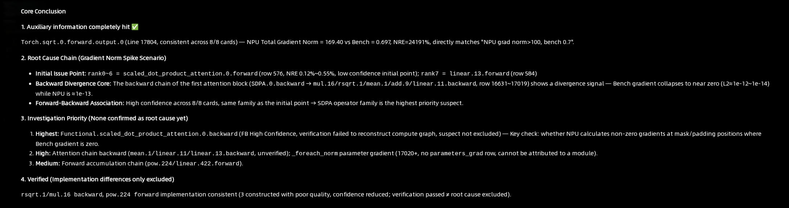
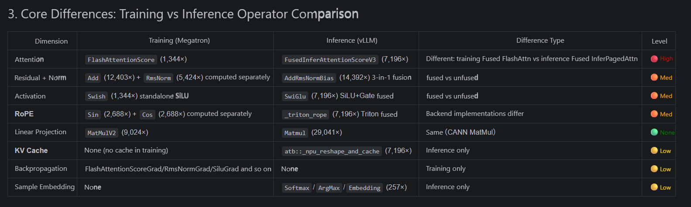
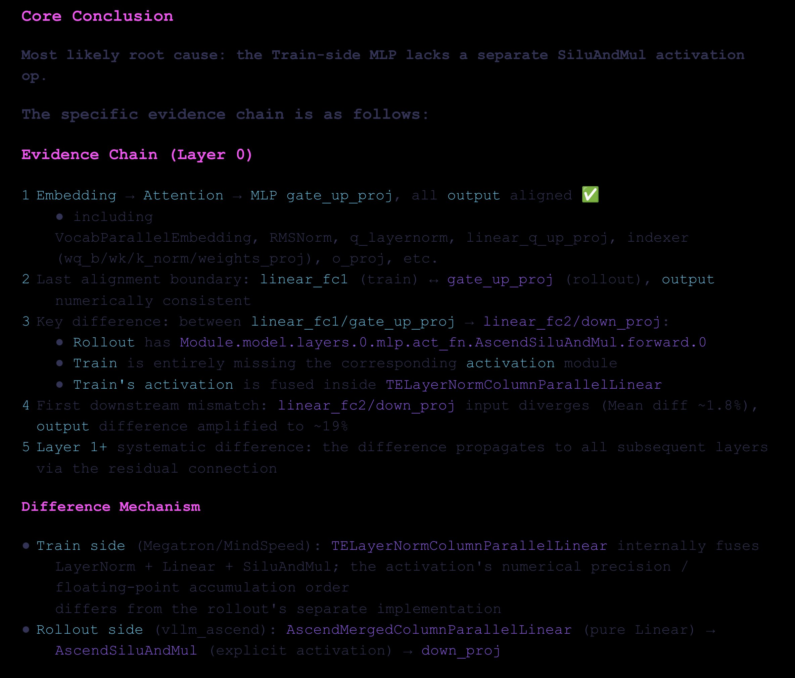
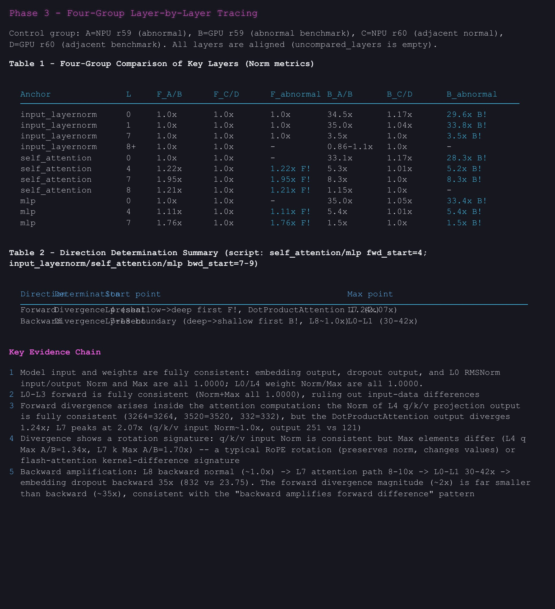
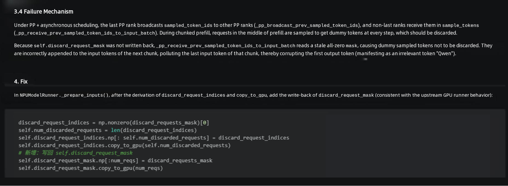

# Accuracy Precision Debugging

`Accuracy` is an agent for model precision debugging. It analyzes and locates precision issues and provides structured conclusions, root-cause analysis, and actionable optimization recommendations.

## 1. Agent Positioning

- Targets Ascend precision analysis scenarios, such as single-device, multi-device, and cluster environments.
- Applies to dump data interpretation and tuning recommendation output.
- Applies to RL training-inference operator difference scans, root-cause analysis of RL training-inference inconsistencies, and location of loss/gnorm NaN and gradient spike issues.
- Applies to the analysis and location of inference precision issues such as garbled or repeated output.

## 2. Core Capabilities

- Location of loss/gnorm NaN issues
- Location of deterministic computing issues
- Location of loss mismatch issues
- RL training-inference operator difference scans
- Root-cause analysis of RL training-inference inconsistencies
- Root-cause location of gradient spikes
- Analysis and location of inference precision issues

## 3. Recommended Usage

- To locate loss/gnorm NaN issues, deterministic computing issues, or loss mismatch issues, or to perform root-cause analysis of RL training-inference inconsistencies, provide the dump data directory path directly and describe the problem you want to solve.
- To run an RL training-inference operator difference scan, provide information about the runtime environment and the RL training script.
- For gradient spike analysis, in addition to the dump statistics of msprobe, you can also provide gradient monitoring data (a monitor CSV generated by the [Monitor Training Status Lightweight Monitoring Tool](https://atomgit.com/Ascend/msprobe/blob/26.2.0/docs/en/user_guide/monitor_instruct.md), or a `trend.db` file obtained by parsing a CSV with [Trend Visualization](https://atomgit.com/Ascend/msprobe/blob/26.2.0/docs/en/user_guide/accuracy_compare/trend_visualization_instruct.md)), and describe the anomaly to facilitate location and analysis.
- For the analysis and location of inference precision issues, provide information such as the issue symptoms and code paths as guided by the agent.
- For cluster or multi-device issues, describe the anomaly, the involved ranks, or the training stage whenever possible.

## 4. Typical Use Scenarios

| Scenario             | Example Prompt | Sample Output |
|----------------|---|--|
| Loss/gnorm NaN overflow analysis | `Based on the input training dump data, analyze the NaN overflow and identify the source device and the root-cause operator.` |  |
| Analysis of inconsistent results when the model runs twice after enabling deterministic computing or switching software versions | `Based on the input MD5 dump data, compare the data, find the difference points, and provide possible causes.` |  |
| Loss mismatch analysis based on comparison results | `Analyze the comparison results and output an analysis report.` |  |
| RL training-inference operator difference scan | `Based on the provided runtime environment and training script, perform a training-inference operator difference scan.` |  |
| RL training-inference inconsistency analysis      | `Based on the input training and inference dump data, analyze the sources of the training-inference differences and provide possible causes.` |  |
| Gradient spike root-cause analysis | `Based on the provided gradient monitoring data, analyze the gradient spikes and locate the root-cause coordinates and the divergence point between the forward and backward passes.` |  |
| Analysis and location of inference precision issues such as garbled or repeated output | `I ran into an inference precision issue.` |  |

## 5. When the Analysis Results Are Incorrect

- You can provide additional supporting information, including the relevant code and correct background knowledge.
- You can raise questions or point out errors to help the agent correct its incorrect viewpoints.
- You can propose analysis directions and key points to guide the agent to analyze further along the relevant clues.

For analysis examples, see [`accuracy_usage_example.md`](../example/accuracy_usage_example.md).
