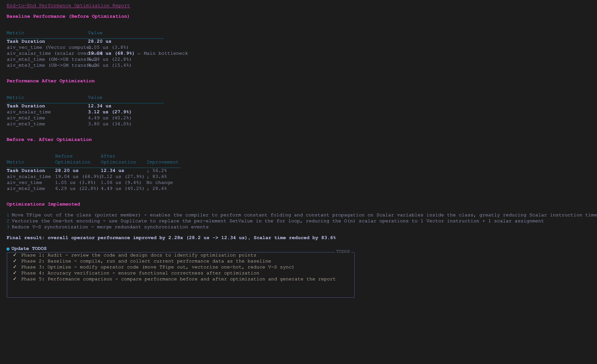

# Operator Tuning

`Operator` is an agent for performance optimization in Ascend operator development scenarios. It converts complex operator performance data into structured, analyzable, and actionable optimization recommendations and provides end-to-end performance optimization capabilities.

## 1. Agent Positioning

- Targets performance optimization scenarios for single-operator development on the Ascend NPU.
- Focuses on locating operator performance bottlenecks and analyzing and outputting optimization recommendations.
- Focuses on end-to-end operator performance optimization.

## 2. Core Capabilities

- Generation of operator performance analysis reports
- MFU calculation, formula explanation, and result interpretation
- Analysis of operator performance load imbalance issues
- Operator performance bottleneck analysis
- One-click end-to-end operator performance optimization

## 3. Recommended Usage

Directly provide the operator `msprof op` data from on-board and simulation runs, the operator kernel files used, and the directly executable operator directory.

## 4. Typical Results

| Scenario | Example Prompt | Sample Output |
|-----------|-----------------------------------|-----------------------------------------------------------------------------|
| End-to-end operator performance optimization | `Perform end-to-end performance optimization based on the operator directory. The operator kernel function is xxx.cpp.` |  |
