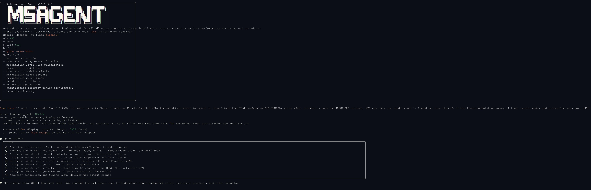
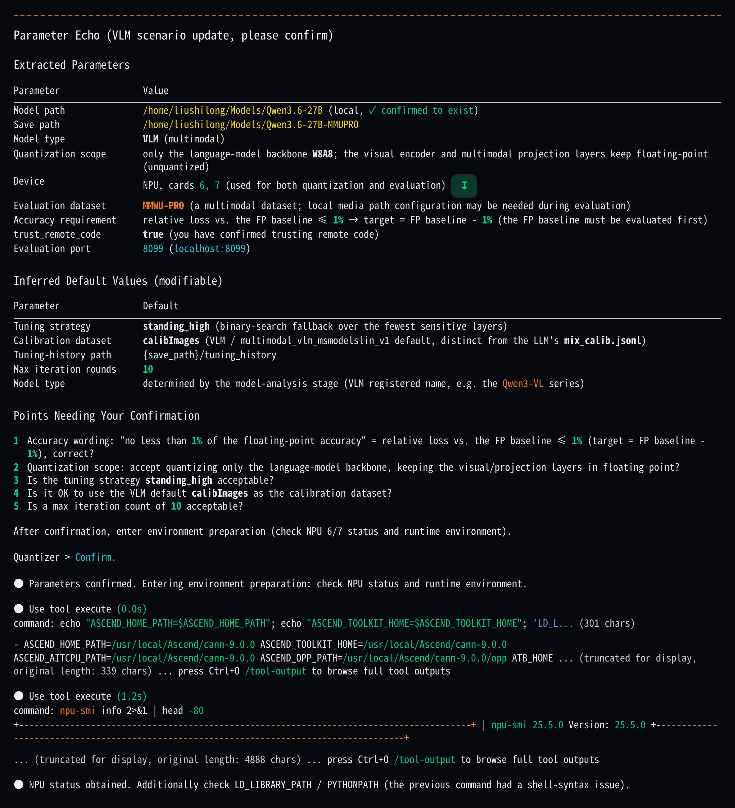
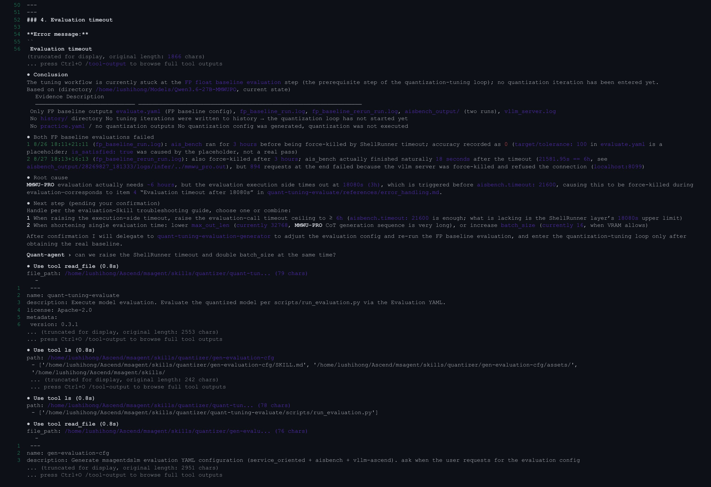
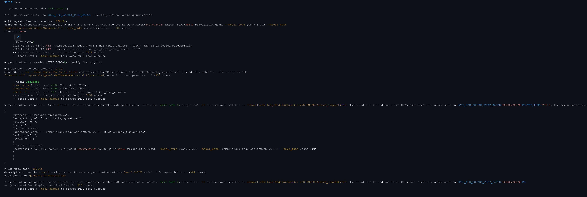

# Best Practices for Automatic Model Quantization Tuning

Taking the Qwen3.6-27B model as an example, this section shows how to use the `Quantizer` agent of msagent to complete quantization configuration generation, model quantization, accuracy evaluation, and automatic tuning end-to-end, and to obtain a quantized model that meets the requirements under a specified accuracy constraint.

## 1. Demonstration

### 1.1 Entering the Requirements and Confirming the Tuning Information

1. In msagent, select the `Quantizer` agent and describe the model path, save path, quantization scheme, device, and accuracy requirements in natural language. For example: "Quantize `/path/to/Qwen3.6-27B` with W8A8, save the quantization result to `/path/to/output`, use NPU 6 and 7, and keep the accuracy loss on the MMMU-PRO dataset within 1%."

   

2. Quantizer extracts key parameters such as the model path, quantization scheme, device numbers, evaluation dataset, accuracy target, and `trust_remote_code`. If any information is missing, it prompts you to provide it. When the information is complete, it echoes the configuration and waits for confirmation.

### 1.2 Automatically Performing Quantization and Accuracy Tuning

1. Quantizer checks msModelSlim, the Ascend environment, and the device status, and confirms whether msModelSlim supports the target model. An unregistered model first goes through the model analysis and adaptation process.
2. It generates the evaluation configuration (Evaluation YAML). If you do not provide the floating-point baseline accuracy, it evaluates the floating-point model first. When an exception such as a timeout occurs, Quantizer summarizes the logs and artifacts, identifies the cause, and provides handling suggestions.
3. After the floating-point baseline is ready, it generates the first-round quantization configuration (Practice YAML) and performs model quantization and accuracy evaluation.
4. It compares the evaluation result with the accuracy target and records the tuning history. If the target is not reached, it adjusts the quantization strategy and starts the next round until it reaches the accuracy target or the maximum number of iterations.

### 1.3 Viewing the Automatic Tuning Results

1. After tuning is complete, Quantizer outputs the save path of the quantized model, the final quantization configuration, the accuracy evaluation result, and the tuning history.
2. If the quantized model reaches the accuracy target, Quantizer delivers a quantized model that meets the requirements. If the maximum number of iterations is reached but the target is still not met, Quantizer outputs the reason for termination and follow-up handling suggestions.

