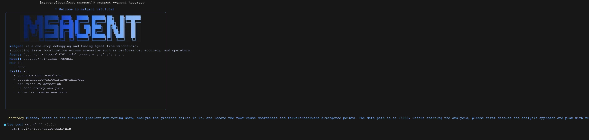
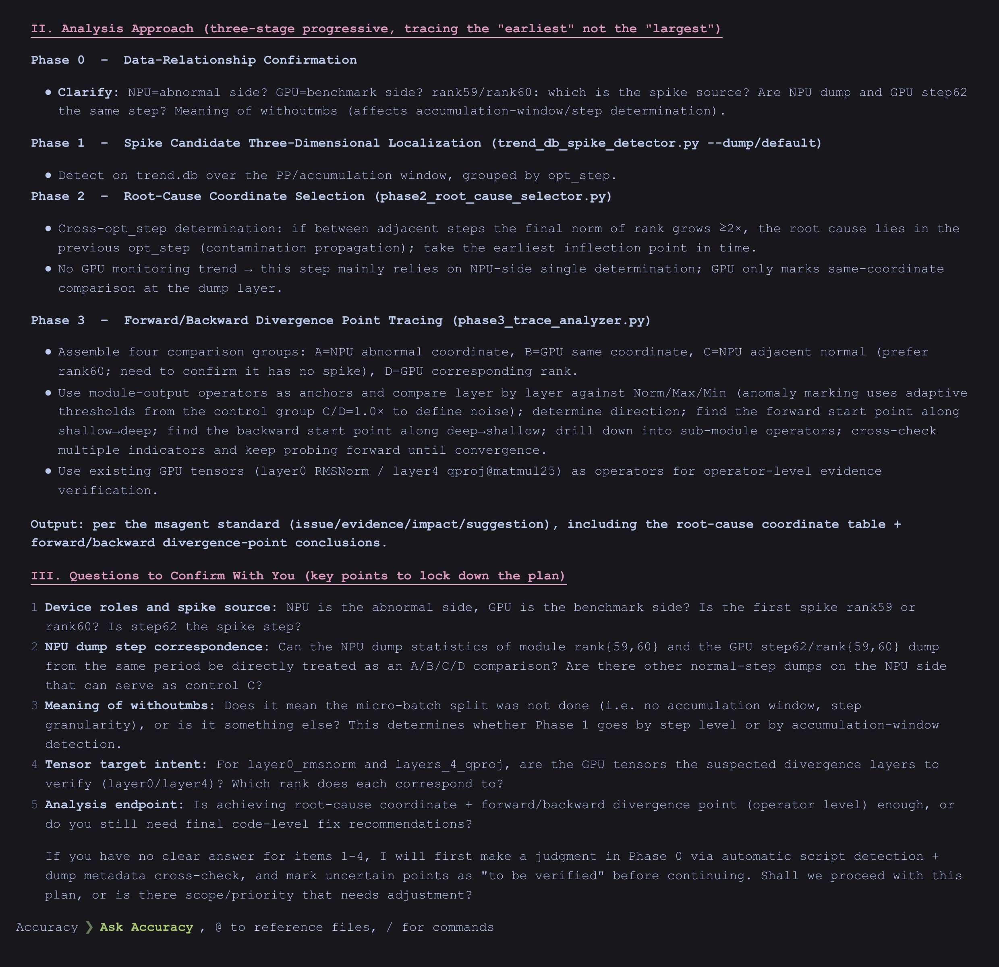
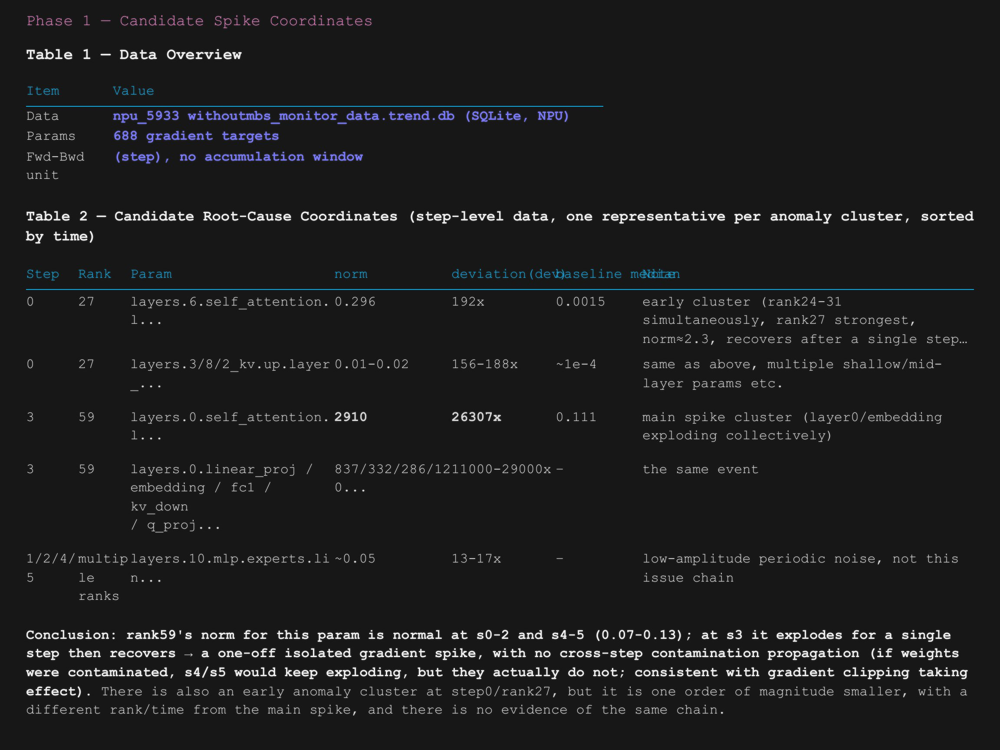
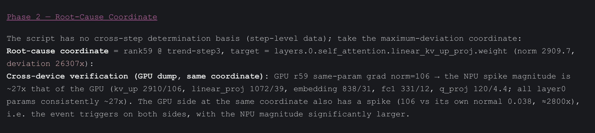
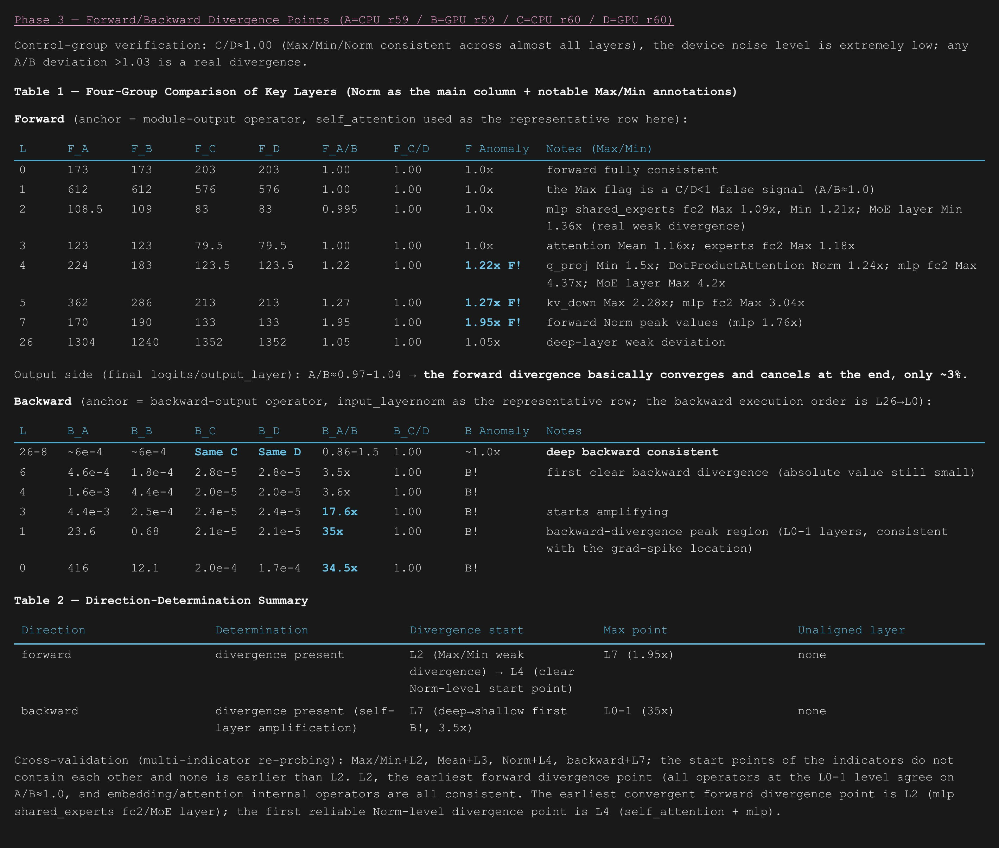
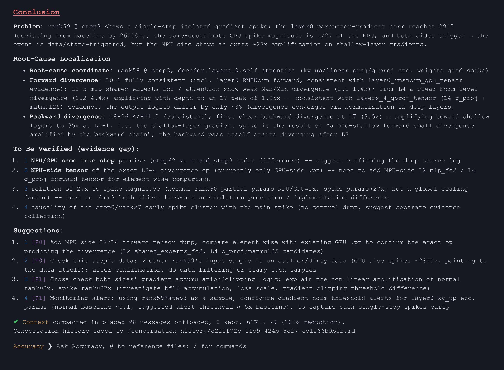

# Precision Issues: Best Practices for Gradient Spike

This section uses a model that shows a gradient spike during distributed training on 64 devices as an example to demonstrate how to complete anomaly coordinate localization for gradient spikes, cross-device comparison, and tracing of the divergence point between the forward and backward passes end-to-end with the precision localization feature module of msagent.

## 1. Background

During distributed training of a model on 64 devices, rank 59 shows a gradient spike at step 3, while the steps before and after it are normal. The debugging environment is an NPU, and dump data at the same coordinates on a GPU is also provided as a cross-device benchmark. You need to answer the following questions: Where are the root-cause coordinates of the spike? Where do the forward and backward passes start to diverge? Is the anomaly device-specific or shared by both sides?

## 2. Data Preparation

The following data is required for this analysis:

| Data | Content | Purpose |
|------|---------|---------|
| npu_xxx_withoutmbs_monitor_data.trend.db | NPU gradient monitoring data: 64 ranks × 6 steps (0 to 5), 688 gradient targets, no step-level accumulation window | Phase 1/2: localization of candidate spike coordinates |
| npu_xxx_dump_statistic/ | NPU dump statistics of the anomaly side (rank 59 and rank 60) | Phase 2/3: dump data alignment and control group construction |
| gpu_xxx_dump_statistic/ | GPU dump statistics of the benchmark side (rank 59 and rank 60) | Phase 2/3: cross-device benchmark comparison |

## 3. Localization Steps

### 3.1 Process

1. Prepare the data: Get the gradient monitoring data (`trend.db`) recorded during training and the detailed data (dump data) of the anomaly devices and the benchmark devices, and confirm the path of the data directory. The more complete the data, the more reliable the analysis.
2. Start the analysis: In the precision analysis module of msagent, enter the initial prompt: "Based on the provided gradient monitoring data, analyze the gradient spikes and locate the root-cause coordinates and the divergence point between the forward and backward passes. The data path is xxx. Before you start the analysis, discuss the analysis approach and plan with me first." The agent first confirms the analysis approach with you and then starts to work.
3. Clarify the approach: First confirm whether this batch of data comes from the same training moment and whether the data can be compared with each other. Then mark all suspicious spike positions in the monitoring data. Next, identify the one most likely to be the root cause and compare it with the benchmark device. Finally, trace layer by layer to find where the forward and backward computations first differ.
4. Obtain the analysis conclusion:
   - Spike position: The spike occurs on device 59 at step 3 of training. The overall gradient behavior of this device is abnormal at this step, and the difference accumulates layer by layer along backpropagation, growing to about 35 times the normal level by the shallow layers (L0 to L1).
   - Device comparison: A spike also occurs at the same position on the GPU, but its magnitude is only about 1/27 of that on the NPU. This indicates that the event that triggers the spike occurs on both sides and is not unique to the NPU. The response magnitude to this event differs by about 27 times between the two sides, which is a behavioral difference between devices.
   - Divergence starting point: After layer-by-layer comparison, the forward computation first shows a slight difference at layer L2, and the difference becomes obvious from layer L4. The backward computation first diverges at layer L7, and the difference grows larger toward the shallow layers.
5. Verify the conclusion: Compare the data of two normal devices (device 60 of the NPU and the GPU) with each other and confirm that their behavior is almost completely consistent. This indicates that the devices themselves have no computation deviation, and the differences found earlier are real problems.
6. Generate a report: Organize the conclusions, the unresolved doubts (such as differences in data numbering and the lack of some on-site data), and follow-up recommendations into a complete report.

### 3.2 Demonstration

#### 3.2.1 Describing the Goal and the Data

Tell the agent what problem you encountered (a gradient spike) and where the data is located, so that the analysis has a clear goal and materials.

#### 3.2.2 Discussing and Determining the Analysis Steps

Work with the agent to clarify the analysis approach: First confirm whether the data can be compared, then find suspicious positions, identify the root cause, and finally trace the divergence point layer by layer.

#### 3.2.3 Finding Candidate Spike Positions (Phase 1)

Mark all suspicious spike points in the monitoring data, just as you first mark abnormal areas on a map.

#### 3.2.4 Identifying the Root Cause and Comparing with the Benchmark Device (Phase 2)

Determine the position most likely to be the root cause among the suspicious points, and then compare it with the GPU benchmark to determine whether the anomaly is device-specific or shared by both sides.

#### 3.2.5 Tracing the Divergence Point Between the Forward and Backward Passes (Phase 3)

Compare the abnormal and normal data layer by layer to find the stage where the forward and backward computations first start to differ.

#### 3.2.6 Obtaining the Analysis Report

The agent organizes the conclusions, doubts, and follow-up recommendations into a complete report for easy follow-up. The main function of gradient spike localization is to help users find the suspicious divergence point where the gradient first differs from the benchmark device, thereby defining the scope of the root cause.

#### 3.2.7 Problem Resolution

The localization of the skill stops at the divergence point, but this step defines the scope of the root cause and points the direction for subsequent fixes. In this case, based on the localization result, the RMSNorm computation of the first two layers (L0 to L1) is investigated, and a cumulative error is confirmed compared with the benchmark. This error is a numerical accumulation difference of the operator, and the spike disappears after the error is aligned.
