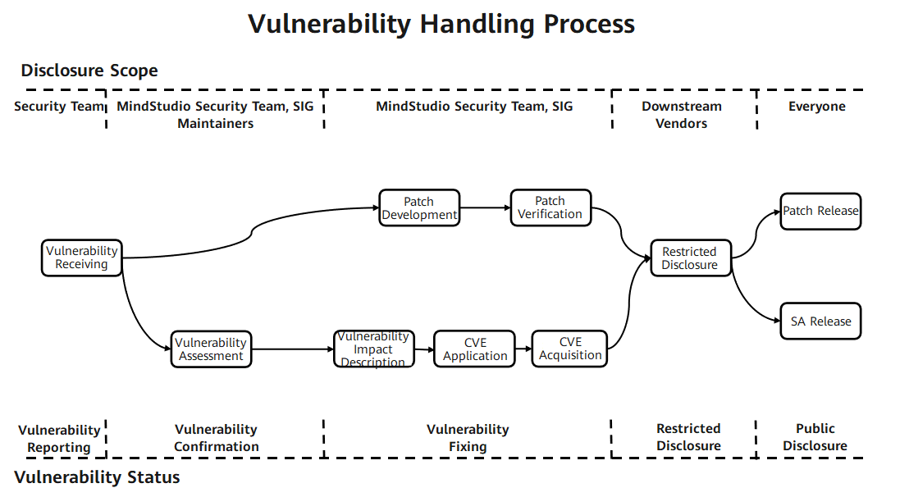

# MindStudio-Agent Security Statement

## System Security Hardening

You are advised to enable **address space layout randomization** (ASLR) at level 2 in the system. Level 2 is also known as full address space layout randomization. Run the following command to enable it:

```bash
echo 2 > /proc/sys/kernel/randomize_va_space
```

## User Account Recommendations

You must ensure that you follow the principle of least privilege. For example, prevent other users from having write permission, and do not set file permissions to 666 or 777.

Before installing or using the tools, ensure that the `umask` value of the executing user is greater than or equal to 0027. Otherwise, issues such as configuration file read failures and excessive permissions of generated directories and files may occur.

The tools in this code repository are designed to be installed and used with low permissions. For security and least privilege purposes, do not operate any tool with high-privilege accounts such as the root account. You are advised to install and run the tools as a regular user.

`msagent` stores user configuration, approval rules, session state, and some runtime artifacts in local files under `MSAGENT_HOME` (default `~/.msagent/`). These files may contain user prompts, tool call parameters, audit records, trace content, and other runtime context. You are responsible for access control and backup protection of the local storage directory. Protect `MSAGENT_HOME` and the host where it resides according to your actual security requirements. Do not write unnecessary sensitive information, such as API keys, tokens, passwords, or Bearer credentials, in prompts, long-term memory, configuration files, or tool parameters.

This repository provides reference configurations for VS Code and devcontainer to facilitate development and debugging. Use them only to develop and debug this repository in a secure debugging environment. In addition, check the security of the configurations yourself and adjust them according to your actual needs.

## File Permission Control

Ensure that the directory permissions are 750.

When you provide an input file to the tool, you are advised to ensure that the owner of the file is the same as the owner of the tool process, and that the file permissions cannot be modified by others (including group and others). By default, files written to the drive by the tool are not writable by others. You can control the permissions of the generated files as needed.

Proper permission control is essential during installation and use. You are advised to refer to the following **File Permission Reference** table for configuration.

**File Permission Reference**

| Type | Maximum Linux Permission |
|------|----------------------|
| User home directory | 750 (`rwxr-x---`) |
| Program files (including script files, library files, and so on) | 550 (`r-xr-x---`) |
| Program file directory | 550 (`r-xr-x---`) |
| Configuration file | 640 (`rw-r-----`) |
| Configuration file directory | 750 (`rwxr-x---`) |
| Log files (recorded or archived) | 440 (`r--r-----`) |
| Log files (being recorded) | 640 (`rw-r-----`) |
| Log file directory | 750 (`rwxr-x---`) |
| Debug file | 640 (`rw-r-----`) |
| Debug file directory | 750 (`rwxr-x---`) |
| Temporary file directory | 750 (`rwxr-x---`) |
| Maintenance and upgrade file directory | 770 (`rwxrwx---`) |
| Service data files | 640 (`rw-r-----`) |
| Service data file directory | 750 (`rwxr-x---`) |
| Key components, private keys, certificates, and ciphertext file directory | 700 (`rwx------`) |
| Key components, private keys, certificates, and encrypted ciphertext | 600 (`rw-------`) |
| Encryption and decryption interfaces and scripts | 500 (`r-x------`) |

## Vulnerability Security Statement

The MindStudio community attaches great importance to the security of the community edition and has appointed a vulnerability management specialist to handle vulnerability-related issues. In addition, to build a more secure AI full-process toolchain, we welcome your participation.

### Vulnerability Handling Process

For each security vulnerability, the MindStudio community will assign personnel to track and handle the vulnerability. The following figure shows the end-to-end process of vulnerability handling.



The following sections explain the vulnerability reporting, assessment, and disclosure processes.

### Vulnerability Reporting

You can contact the MindStudio community team by submitting an issue. We will immediately assign a dedicated security vulnerability specialist to contact you. Note that to ensure security, do not include specific information about security privacy in the issue.

**Response to Reports**

- The MindStudio community will confirm, analyze, and report the security vulnerability within three working days, and start the security handling process.
- After confirming the security vulnerability, the MindStudio security team will distribute and follow up the issue.
- During the process of classifying, confirming, fixing, and releasing security vulnerabilities, we will provide timely updates on the report.

### Vulnerability Assessment

The CVSS standard is widely used in the industry to assess the severity of vulnerabilities. When using CVSS v3.1 to assess vulnerabilities, MindStudio needs to set the vulnerability attack scenario and assess the vulnerability based on the actual impact in the attack scenario. Vulnerability severity assessment involves assessing the difficulty of exploitation as well as the impact on confidentiality, integrity, and availability after exploitation, and generating a score.

#### Vulnerability Assessment Metrics

MindStudio uses the following vectors to assess the severity of a vulnerability:

- Attack vector (AV): indicates the "remoteness" of an attack and how a vulnerability can be exploited.
- Attack complexity (AC): describes the difficulty of executing an attack and the factors required for a successful attack.
- User interaction (UI): determines whether the attack requires user participation.
- Privileges required (PR): records the level of user authentication required for a successful attack.
- Scope (S): determines whether an attack can affect components with different permission levels.
- Confidentiality (C): measures the impact resulting from information disclosure to unauthorized parties.
- Integrity (I): measures the impact resulting from information tampering.
- Availability (A): measures the extent to which users are affected when they need to access data or services.

#### Assessment Principles

- Assess the severity level of a vulnerability, not the risk.
- The assessment must be based on an attack scenario where a successful attack can compromise the confidentiality, integrity, and availability of the system.
- When a security vulnerability has multiple attack scenarios, the attack scenario with the highest CVSS score (that is, with the greatest impact) shall prevail in the assessment.
- If a vulnerability exists in an embedded or invoked library, perform the assessment after determining the attack scenario based on how the library is used in the product.
- The CVSS score is 0 if the security defect cannot be triggered or does not affect confidentiality, integrity, and availability (CIA).

#### Assessment Procedure

To assess the severity level of a vulnerability, perform the following steps:

1. Set a possible attack scenario and score based on this attack scenario.
2. Identify the vulnerable component and the affected component.
3. Select values for base metrics.
   - Select values for the exploitability metrics (attack vector, attack complexity, privileges required, user interaction, and scope) based on the vulnerable component.
   - Ensure that the impact metrics (confidentiality, integrity, and availability) reflect the impact on either the vulnerable component or the affected component, whichever is more severe.

#### Severity Rating

| Severity Rating | CVSS Score | Vulnerability Fix Time |
|------------------------------|--------------------|--------------|
| Critical | 9.0 to 10.0 | 7 days |
| High | 7.0 to 8.9 | 14 days |
| Medium | 4.0 to 6.9 | 30 days |
| Low | 0.1 to 3.9 | 30 days |

### Vulnerability Disclosure

After a security vulnerability is fixed, the MindStudio community will release a security advisory (SA) and security notice (SN). The security advisory includes the technical details, type, reporter, CVE ID, and affected and fixed versions of the vulnerability. To protect the security of MindStudio users, the MindStudio community will not disclose, discuss, or confirm the security issues of MindStudio products before the investigation, fixing, and release of the security advisory.

### Appendix

#### MindStudio Security Advisory (SA)

Currently maintained versions have no security vulnerabilities.

#### MindStudio Security Notice (SN)

Vulnerability descriptions for third-party open-source components:

| CVE ID | Third-Party Component Name | Affected MindStudio Tool/Plugin Name | Status | Description |
|----------|----------------|-------------------------------|------|------|
| | | | | |

## Data Security Statement

Loading and saving data during the use of the tools may involve data risks.

## Build Security Statement

`msagent` supports source code compilation and installation. During compilation, dependent third-party libraries are downloaded and the build shell script is executed. Temporary program files and compilation directories are generated during the compilation. To reduce security risks, you can control permissions on files in the source code directory as needed. During the build process, you can modify build scripts as needed to avoid related security risks and ensure the security of the build results.

## Runtime Security Statement

If an exception occurs during operation, the tool exits the process and prints error messages. This is expected behavior. You are advised to locate the specific cause of the error based on the error messages, such as by viewing log files or session state files.

## Public API Statement

The `msagent` project is developed using Python. All the external interfaces provided are disclosed in the documentation. For scripting languages such as Python whose source code is released, you are advised to use the public APIs specified in the documentation and not to directly call the source code of APIs that are not explicitly disclosed.

## Usage of Safe Functions

Unsafe functions are not forcibly disabled, but you are advised to use the `_s` safe variants that explicitly take a buffer length parameter, for example, `memset_s` and `memcpy_s`.
