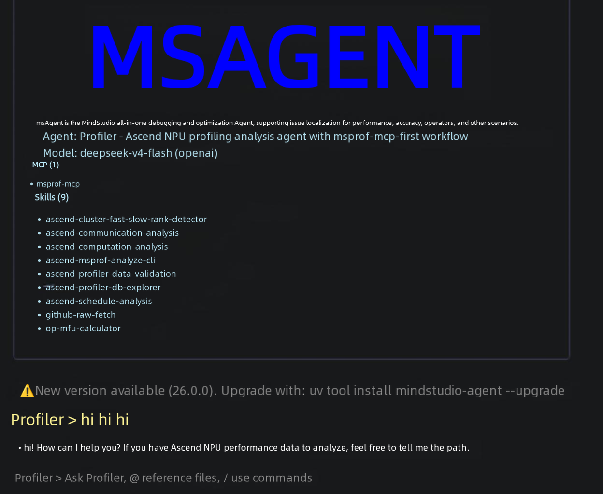
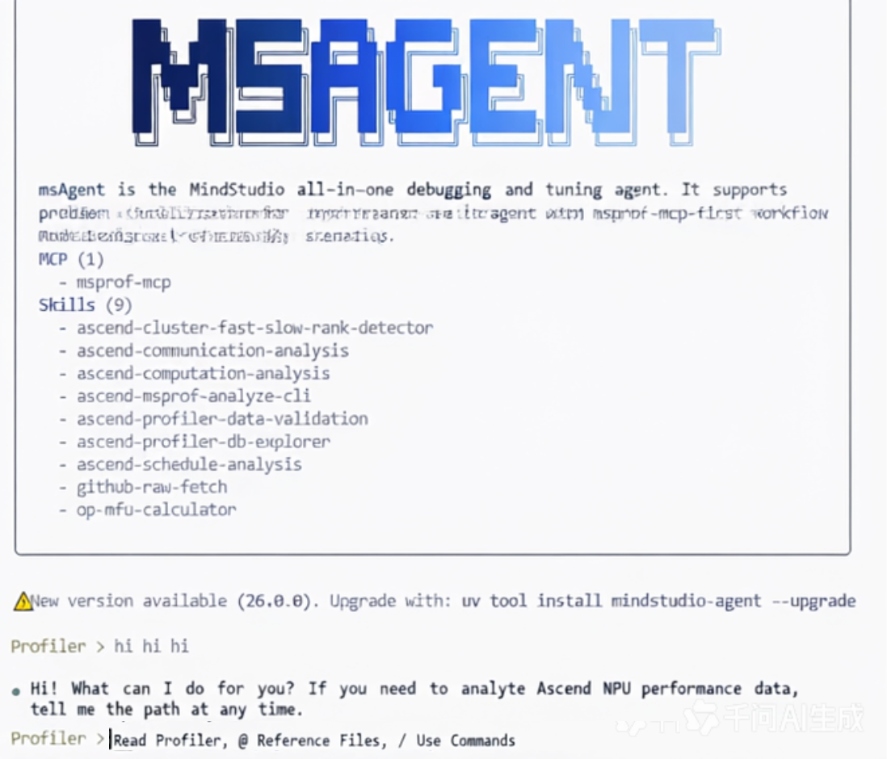

# FAQ

## 1. What Local Files Does msagent Generate on First Startup?

`msagent` uses a global configuration directory. The default location is:

```text
~/.msagent/
```

In this directory, `config/` stores user override configuration, and `state/projects/<project-id>/` stores the memory, history, checkpoints, and session history of each project. No new `.msagent/` is generated in the working directory.

This directory typically contains:

- LLM configuration
- MCP configuration
- Skills installed by the user
- Logs, cache, session history, and checkpoint data

The built-in agent and subagent definitions and prompts are provided directly by the installation package by default and are not copied here on first startup. The agent and model selected in the current workspace are recorded in the `project.json` of the corresponding project.

For a more complete description of the directory, see [Configuration and Extension](../user_guide/configuration-and-extension.md).

## 2. How Do You Enable or Disable MCP Services?

There are two common ways:

- Use `/mcp` in a session to view and switch the configured MCP services.
- Edit `~/.msagent/config/config.mcp.json` directly.

The default template enables `msprof-mcp`. If you want to connect a new local or remote MCP service, you are advised to first refer to the field descriptions in [Configuration and Extension](../user_guide/configuration-and-extension.md).

## 3. How Can You Confirm That a Skill Is Recognized?

After you enter a session, run:

```text
/skills
```

To view a specific skill:

```text
/skills my-skill
```

If your skill has a category directory, you are advised to write the full path:

```text
/skills profiler/my-skill
```

If it does not appear, check the following first:

- Whether the path is correct
- Whether the file name is `SKILL.md`
- Whether the `skills.patterns` setting of the current agent allows the skill
- Whether a skill with the same name in a higher-priority directory overrides it

To load a custom skill, see [Adding a Custom Skill](../user_guide/configuration-and-extension.md#9-adding-a-custom-skill).

## 4. Where Can You View the Runtime Logs?

Logs are written to the global directory:

```text
~/.msagent/logs/app.log
```

If you want to see more detailed logs, you can enable:

```bash
export MSAGENT_LOG_LEVEL=DEBUG
msagent -v
```

## 5. What If the Terminal Interface Colors Look Gray or Are Hard to Read?

`msagent` automatically detects the terminal theme (dark or light) to match the color scheme. If the detection is inaccurate (for example, when the theme is misjudged as light during an SSH connection, causing the text to look gray on a dark terminal), you can specify the theme manually through an environment variable:

```bash
export MSAGENT_BACKGROUND_THEME=dark
```

Available values:

| Value | Meaning | |
| --- | --- | --- |
| dark | Forces the dark background theme (Tokyo Night), with a corresponding light font. |  |
| light | Forces the light background theme (Tokyo Day), with a corresponding dark font. |  |

## 6. What If the MobaXterm Terminal Background Is White or Has No Color?

MobaXterm does not set `COLORTERM` by default. Therefore, `prompt_toolkit` cannot recognize true-color support, and the interface may display a white background or no color. Set the following environment variable to restore it:

```bash
export COLORTERM=truecolor
```

## 7. What If pip Reports a Dependency Conflict or the Installation Fails When Installing mindstudio-agent?

Running `pip install mindstudio-agent` directly writes into the current Python environment, easily conflicts with existing dependencies (such as torch and mindstudio_monitor), or triggers the PEP 668 (externally-managed-environment) restriction on Ubuntu 22.04 and later.

You are advised to use one-click installation instead (an isolated environment that does not affect the existing environment):

```shell
# Linux / macOS / WSL
curl -LsSf https://raw.atomgit.com/Ascend/msagent/raw/26.2.0/scripts/install.sh | bash

# Windows (PowerShell 5.1+)
irm https://raw.atomgit.com/Ascend/msagent/raw/26.2.0/scripts/install.ps1 | iex
```

Common error messages:

| Error Symptom | Cause | Solution |
| --- | --- | --- |
| `externally-managed-environment` | The system Python is protected by PEP 668. | Use one-click installation, or create a virtual environment before installing with pip. |
| `Requires-Python >=3.11` or a version that is too low | The current Python version is lower than 3.11. | One-click installation automatically downloads Python 3.11 and requires no manual upgrade. |
| Dependency conflicts (such as mismatched pydantic or langchain versions) | Version conflicts with packages in the existing environment | Use one-click installation (an independent uv tool environment). |
| Installation timeout or download failure | Unstable network access to PyPI | One-click installation uses a domestic mirror by default. Alternatively, set `MSAGENT_INDEX` to specify a mirror. |

## 8. How Do You Upgrade or Uninstall msagent?

The command depends on the installation method. One-click installation uses an isolated uv tool environment, and you cannot uninstall it with pip.

| Installation Method | Upgrade | Uninstall |
| --- | --- | --- |
| One-click installation/`uv tool install` (uv tool method) | Rerun the one-click installation command, or run `uv tool upgrade mindstudio-agent`. | uv tool uninstall mindstudio-agent |
| Virtual environment + pip (such as `~/.msagent-venv`) | `~/.msagent-venv/bin/pip install -U mindstudio-agent` | ~/.msagent-venv/bin/pip uninstall -y mindstudio-agent |
| pip in the current Python environment (source code installation) | `pip install -U mindstudio-agent` | pip uninstall mindstudio-agent |

When you are not sure, use `uv tool list`, `command -v msagent`, and `pip show mindstudio-agent` to check. For details, see [msAgent Installation Guide §5.1-5.2](../install_guide/msagent_install_guide.md#52-selecting-the-upgrade-and-uninstall-command-by-installation-method). After one-click installation, running `pip uninstall mindstudio-agent` only prompts `Skipping mindstudio-agent as it is not installed`, and the uninstall does not take effect.

## 9. What If `ascend-doc-mcp preparation did not complete` Is Reported When Installing in an Intranet Environment?

This warning only affects the optional **documentation query service** (`ascend-doc-mcp`, that is, the material retrieval of the `ascend-knowledge` subagent). The `msagent` itself is already installed and available, and only this subagent reports that "material query is temporarily unavailable". This service requires Node.js ≥ 22 and an accessible npm registry.

**The simplest fix** — point npm to the intranet registry and rerun the installation, after which no warning appears:

```shell
npm config set registry http://<intranet npm registry>/    # Writes to the npm configuration, and both the installer and the launcher adopt it automatically
bash scripts/install.sh
```

**Automatic Behavior** (no configuration is required in most cases):

- The installer preferentially uses the registry already configured in the local npm, and finally falls back to a built-in intranet mirror. Public network machines are not affected.
- When selecting a registry, it probes all candidates in parallel first and installs only from reachable registries. Unreachable registries are skipped quickly.
- After preinstallation succeeds, the runtime uses the local copy directly. Therefore, **npm is no longer required, and it can work offline**.

**Common Switches**:

| Variable | Description |
| --- | --- |
| MSAGENT_NPM_REGISTRY | Temporarily specifies the npm registry (`MSAGENT_NPM_REGISTRY_ONLY=1` means to use only it). |
| MSAGENT_NPM_REGISTRY_FALLBACKS | Appends fallback registries (comma-separated), for unified injection in an intranet. |
| MSAGENT_NODE_HOME | Reuses an existing Node installation directory and skips the automatic download. |
| MSAGENT_NO_ASCEND_DOC_MCP=1 | Skips this feature directly when it is not needed, with zero warnings during installation. |

For other variables (Node mirror, proxy, cache, and so on), see the comments at the head of the script. If the local machine does not have Node ≥ 22, you can obtain `node-v22.x.y-linux-x64.tar.xz` from `https://mirrors.huaweicloud.com/nodejs/latest-v22.x/`, extract it, and add it to PATH (the script also prints the corresponding command when the installation fails).

## 10. What If `command not found` Is Prompted When You Run `msagent` After One-Click Installation?

One-click installation only writes the uv tool directory to the shell startup file and does not modify the currently open terminal. Run the command printed at the end of the installer log (usually `source ~/.bashrc`) or reopen the terminal.

When the log prompts "add \<tool directory\> to PATH yourself" (for example, when `MSAGENT_NO_MODIFY_PATH=1` is set), set it manually:

```shell
export PATH="$(uv tool dir --bin):${PATH}"                       # Takes effect in the current session
echo "export PATH=\"$(uv tool dir --bin):\$PATH\"" >> ~/.bashrc  # Persists the setting
```

Windows: In PowerShell, use `$env:PATH = "$(uv tool dir --bin);$env:PATH"`. In cmd, use `set PATH=<tool directory>;%PATH%`. For details, see [msAgent Installation Guide §4.1](../install_guide/msagent_install_guide.md#41-what-to-do-if-command-not-found-is-prompted-after-installation).
