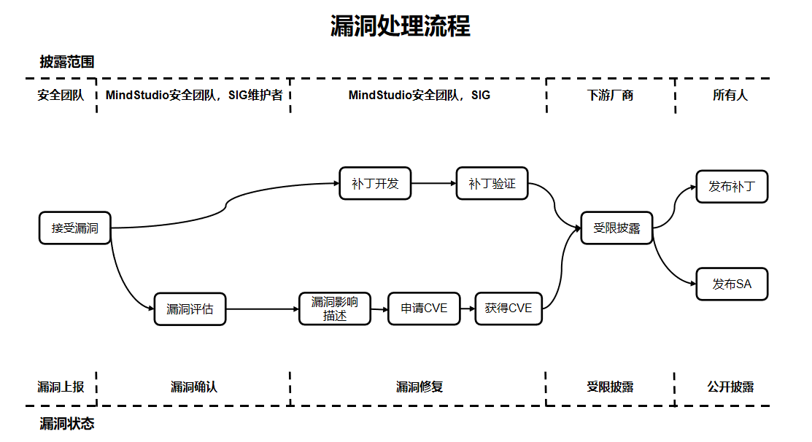

# MindStudio-Agent 安全声明

## 系统安全加固

建议用户在系统中配置开启 ASLR（级别 2），又称全随机地址空间布局随机化，可参考以下方式进行配置：

```bash
echo 2 > /proc/sys/kernel/randomize_va_space
```

## 运行用户建议

用户须自行保证使用最小权限原则（如禁止 other 用户拥有写权限，常见如禁止将文件权限设置为 666 或 777）。

安装或使用工具前请确保执行用户的 umask 值大于等于 0027，否则会导致读取配置文件失败、生成的目录和文件权限过大等问题。

本代码仓中的工具均设计为低权限安装使用，出于安全性及权限最小化角度考虑，所有工具均不应使用 root 等高权限账户，建议使用普通用户权限安装执行。

`msagent` 会将用户配置、审批规则、会话状态和部分运行期产物保存在 `MSAGENT_HOME`（默认 `~/.msagent/`）下的本地文件中。这些文件可能包含用户 prompt、工具调用参数、审计记录、trace 内容以及其他运行上下文。本地存储目录的访问控制与备份保护由用户自行负责。请根据实际安全要求保护 `MSAGENT_HOME` 及其所在主机，不要在 prompt、长期记忆、配置文件或工具参数中写入不必要的 API Key、Token、密码、Bearer 凭据等敏感信息。

本仓提供 vscode 及 devcontainer 参考配置，便于开发调试，仅限用于安全的调试环境中对本仓进行开发与调试使用，另外请自行检查配置安全性并根据实际需求做调整。

## 文件权限控制

用户需保证目录权限为 750。

用户向工具提供输入文件时，建议提供的文件属主与工具进程属主一致，且文件权限他人不可修改（包括 group、others）。工具落盘文件权限默认他人不可写，用户可根据需要自行对生成后的相关文件进行权限控制。

用户安装和使用过程需要做好权限控制，建议参见下表文件权限参考进行设置。

**文件权限参考**

| 类型 | Linux 权限参考最大值 |
|------|----------------------|
| 用户主目录 | 750（rwxr-x---） |
| 程序文件（含脚本文件、库文件等） | 550（r-xr-x---） |
| 程序文件目录 | 550（r-xr-x---） |
| 配置文件 | 640（rw-r-----） |
| 配置文件目录 | 750（rwxr-x---） |
| 日志文件（记录完毕或者已经归档） | 440（r--r-----） |
| 日志文件（正在记录） | 640（rw-r-----） |
| 日志文件目录 | 750（rwxr-x---） |
| Debug 文件 | 640（rw-r-----） |
| Debug 文件目录 | 750（rwxr-x---） |
| 临时文件目录 | 750（rwxr-x---） |
| 维护升级文件目录 | 770（rwxrwx---） |
| 业务数据文件 | 640（rw-r-----） |
| 业务数据文件目录 | 750（rwxr-x---） |
| 密钥组件、私钥、证书、密文文件目录 | 700（rwx------） |
| 密钥组件、私钥、证书、加密密文 | 600（rw-------） |
| 加解密接口、加解密脚本 | 500（r-x------） |

## 命令审批与授权风险

`msagent` 支持 Safe Mode 和 Convenience Mode 两种 shell 命令审批模式，可通过 `/permissions` 查看或切换。Safe Mode 下白名单默认批准、黑名单和普通命令逐条确认；Convenience Mode 下普通命令默认批准、黑名单逐条确认。

`approve` / `reject` 仅本次生效；黑名单的 always 规则只保存到会话内，Safe Mode 普通命令的项目级 always 规则会持久化到 `~/.msagent/state/projects/<project-id>/config.approval.json`。用户应谨慎授权删除文件、修改 Git 历史、推送代码、提升权限、安装依赖、执行远程脚本、访问网络或处理敏感数据的命令，并自行承担已授权命令的执行风险。

命令白名单和黑名单仅用于启发式分类，不是安全边界。命令可以通过解释器、脚本、别名、环境变量、命令替换或其他包装方式间接执行操作，因此即使分类结果不是黑名单，用户仍应逐条检查待执行命令；人工确认是最终防线。

当前版本的 `msagent` 不会在用户工作目录下生成 `.msagent/`，也不会为了忽略这些文件而自动修改 `.git/info/exclude` 或 `.gitignore`。如需配置 Git 忽略规则，请由用户自行按需设置。

## MCP 服务与第三方工具风险

MCP Server 不是可信沙箱。本地 `stdio` MCP 通常以当前用户权限运行；远程 MCP 可能将调用所需的 prompt、文件内容、工具参数或认证信息发送给第三方服务。

启用前请审查服务来源、命令、URL、请求头和工具范围，仅授予必要权限，不要写入不必要的敏感信息。超时设置不能替代隔离和权限控制；用户需对自行配置或调用 MCP Server 产生的执行、数据泄露和合规风险负责。

## 漏洞安全声明

MindStudio 社区非常重视社区版本的安全性，专门设置了漏洞管理专员负责处理漏洞相关的事务，同时为了构建更安全的 AI 全流程工具链，我们也欢迎您一起参与。

### 漏洞处理流程

对于每一个安全漏洞，MindStudio 社区会安排人员进行跟踪和处理，漏洞处理的端到端流程如下图所示。



下面将重点解释漏洞上报、漏洞评估、漏洞披露的流程。

### 漏洞上报

您可以通过提交 Issue 的方式联系 MindStudio 社区团队，我们将会第一时间安排安全漏洞专项人员向您联系。注意，为了确保安全性，请不要在 Issue 中描述涉及安全隐私的具体信息。

**上报响应**

- MindStudio 社区会在 3 个工作日内确认、分析、上报安全漏洞问题，同时启动安全处理流程。
- MindStudio 安全团队在确认安全漏洞问题后，会对问题进行分发和跟进。
- 在安全漏洞问题从分类、确定、修复和发布的过程中，我们会及时更新报告。

### 漏洞评估

业界普遍使用 CVSS 标准评估漏洞的严重性，MindStudio 在使用 CVSS v3.1 进行漏洞评估时，需要设定漏洞攻击场景，基于在该攻击场景下的实际影响进行评估。漏洞严重等级评估是指针对漏洞利用难易程度，以及利用后对机密性、完整性、可用性的影响进行评估，并生成一个评分值。

#### 漏洞评估标准

MindStudio 通过以下向量评估一个漏洞的严重等级：

- 攻击向量（AV）：表示攻击的“远程性”以及如何利用此漏洞。
- 攻击复杂性（AC）：讲述攻击执行的难度以及成功进行攻击需要哪些因素。
- 用户交互（UI）：确定攻击是否需要用户参与。
- 所需的权限（PR）：记录成功进行攻击所需的用户身份验证级别。
- 范围（S）：确定攻击者是否可以影响具有不同权限级别的组件。
- 机密性（C）：衡量信息泄露给非授权方后导致的影响程度。
- 完整性（I）：衡量信息被篡改后导致的影响程度。
- 可用性（A）：衡量用户在需要访问数据或服务时受影响的程度。

#### 评估原则

- 评估漏洞的严重等级，不是评估风险。
- 评估时必须基于攻击场景，且保证在该场景下，攻击者成功攻击后能对系统造成机密性、完整性、可用性影响。
- 当安全漏洞有多个攻击场景时，应以造成最大的影响，即 CVSS 评分最高的攻击场景为依据。
- 被嵌入调用的库存在漏洞，要根据该库在产品中的使用方式，确定漏洞的攻击场景后进行评估。
- 安全缺陷不能被触发或不影响 CIA（机密性、完整性、可用性），CVSS 评分为 0 分。

#### 评估步骤

评估漏洞严重等级时，可根据下述步骤进行操作：

1. 设定可能的攻击场景，基于攻击场景评分。
2. 确定漏洞组件（Vulnerable Component）和受影响组件（Impact Component）。
3. 选择基础指标的值。
   - 可利用指标（攻击向量、攻击复杂度、所需权限、用户交互、范围）根据漏洞组件选择指标值。
   - 影响指标（机密性、完整性、可用性）要么反映对漏洞组件的影响，要么反映对受影响组件影响，以结果最严重的为准。

#### 严重等级划分

| 严重等级（Severity Rating） | CVSS 评分（Score） | 漏洞修复时长 |
|------------------------------|--------------------|--------------|
| 致命（Critical） | 9.0~10.0 | 7 天 |
| 高（High） | 7.0~8.9 | 14 天 |
| 中（Medium） | 4.0~6.9 | 30 天 |
| 低（Low） | 0.1~3.9 | 30 天 |

### 漏洞披露

安全漏洞修复后 MindStudio 社区会发布安全公告（SA）以及安全说明（SN），安全公告内容包括该漏洞的技术细节、类型、上报人、CVE ID 以及受到该漏洞影响的版本和修复版本等信息。为了保护 MindStudio 用户的安全，在进行调查、修复和发布安全公告之前，MindStudio 社区不会公开披露、讨论或确认 MindStudio 产品的安全问题。

### 附录

#### MindStudio 安全公告（SA）

目前在维护版本，无安全漏洞。

#### MindStudio 安全说明（SN）

涉及第三方的开源组件部分漏洞说明：

| CVE 编号 | 第三方组件名称 | 涉及 MindStudio 工具/插件名称 | 状态 | 说明 |
|----------|----------------|-------------------------------|------|------|
| | | | | |

## 数据安全声明

工具使用过程中需要加载和保存数据，可能存在数据风险。

## 构建安全声明

`msagent` 支持源码编译安装，在编译时会下载依赖第三方库并执行构建 shell 脚本，在编译过程中会产生临时程序文件和编译目录。用户可根据需要自行对源代码目录内的文件进行权限管控降低安全风险，用户在构建过程中可根据需要修改构建脚本以避免相关安全风险，并注意构建结果的安全。

## 运行安全声明

工具在运行异常时会退出进程并打印报错信息，属于正常现象。建议用户根据报错提示定位具体错误原因，包括查看日志文件、会话状态文件等方式。

## 公开接口声明

`msagent` 项目采用 Python 开发，提供的对外接口均已在资料中公开。Python 等脚本语言源码发布时，建议直接使用资料说明的公开接口，不建议直接调用未明确公开的接口源码。

## 安全函数使用说明

不强制禁用不安全函数，但推荐使用缓冲区长度作为参数明确传入的 `_s` 安全版本，如 `memset_s`、`memcpy_s` 等。
