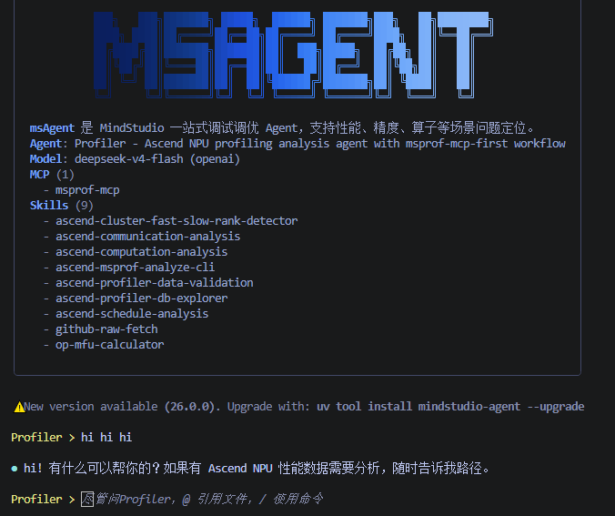
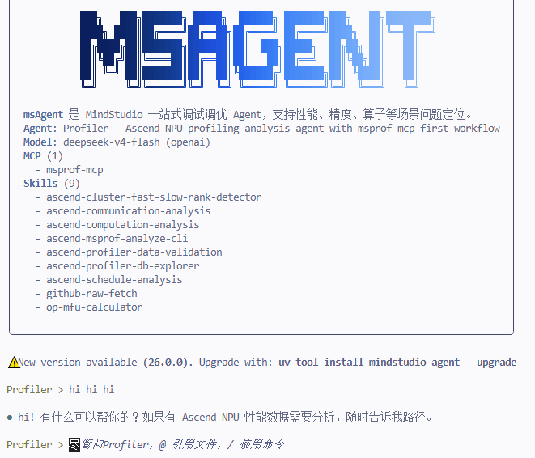

# FAQ

## 1. msagent 第一次启动时会生成哪些本地文件？

`msagent` 使用全局配置目录。默认位置为：

```text
~/.msagent/
```

其中 `config/` 保存用户覆盖配置，`state/projects/<project-id>/` 保存各项目独立的 memory、history、checkpoint 和会话历史。工作目录不会生成新的 `.msagent/`。

这个目录里通常会包含：

- LLM 配置
- MCP 配置
- 用户安装的 Skills
- 日志、缓存、会话历史和 checkpoint 数据

内置 Agent / SubAgent 定义和 Prompt 默认由安装包直接提供，不会在首次启动时复制到这里。当前 Workspace 选择的 Agent 和 Model 记录在对应项目的 `project.json` 中。

更完整的目录说明见 [配置与扩展](../user_guide/configuration-and-extension.md)。

## 2. 如何打开或关闭 MCP 服务？

有两种常见方式：

- 在会话里通过 `/mcp` 查看和切换已配置的 MCP 服务
- 直接编辑 `~/.msagent/config/config.mcp.json`

默认模板会启用 `msprof-mcp`。如果你要接入新的本地或远程 MCP 服务，建议先参考 [配置与扩展](../user_guide/configuration-and-extension.md) 里的字段说明。

## 3. 如何确认 Skill 是否被识别到了？

进入会话后，可以执行：

```text
/skills
```

如果要查看某个具体 Skill：

```text
/skills my-skill
```

如果你的 Skill 带分类目录，建议写全路径：

```text
/skills profiler/my-skill
```

如果看不到，通常优先检查：

- 路径是否正确
- 文件名是否为 `SKILL.md`
- 当前 Agent 的 `skills.patterns` 是否允许该 Skill
- 是否被更高优先级目录中的同名 Skill 覆盖

加载自定义 Skill，可参考[添加自定义 Skill](../user_guide/configuration-and-extension.md#9-添加自定义-skill)。

## 4. 运行日志在哪里看？

日志统一写到全局目录：

```text
~/.msagent/logs/app.log
```

如果你想看到更详细的日志，可以开启：

```bash
export MSAGENT_LOG_LEVEL=DEBUG
msagent -v
```

## 5. 终端界面颜色偏灰/看不清怎么办？

msagent 会自动检测终端主题（深色/浅色）来匹配配色方案。如果检测不准（比如 SSH 连接时误判为浅色主题，导致深色终端上文字偏灰），可通过环境变量手动指定：

```bash
export MSAGENT_BACKGROUND_THEME=dark
```

可选值：

| 值 | 含义                               |                                     |
|----|----------------------------------|-------------------------------------|
| `dark` | 强制使用背景为深色主题（Tokyo Night），对应字体为浅色 |   |
| `light` | 强制使用背景为浅色主题（Tokyo Day），对应字体为深色   |                                     |

## 6. MobaXterm 终端背景为白色/无彩色怎么办？

MobaXterm 默认未设置 `COLORTERM`，导致 prompt_toolkit 无法识别真彩色支持，界面可能显示为白色背景或无彩色。设置以下环境变量即可恢复：

```bash
export COLORTERM=truecolor
```

## 7. pip 安装 mindstudio-agent 时提示依赖冲突或安装失败怎么办？

直接 `pip install mindstudio-agent` 会写入当前 Python 环境，容易与已有依赖（如 torch、mindstudio_monitor 等）冲突，或在 Ubuntu 22.04+ 上遇到 PEP 668（externally-managed-environment）限制。

推荐改用一键安装（隔离环境，不影响现有环境）：

```shell
# Linux / macOS / WSL
curl -LsSf https://raw.gitcode.com/Ascend/msagent/raw/26.2.0/scripts/install.sh | bash

# Windows（PowerShell 5.1+）
irm https://raw.gitcode.com/Ascend/msagent/raw/26.2.0/scripts/install.ps1 | iex
```

常见报错对照：

| 报错现象 | 原因 | 处理方法 |
| --- | --- | --- |
| `externally-managed-environment` | 系统 Python 受 PEP 668 保护 | 使用一键安装，或先创建虚拟环境再 pip 安装 |
| `Requires-Python >=3.11` 或版本过低 | 当前 Python 版本低于 3.11 | 一键安装会自动下载 Python 3.11，无需手动升级 |
| 依赖冲突（如 pydantic、langchain 版本不匹配） | 与现有环境包版本冲突 | 使用一键安装（uv 独立工具环境） |
| 安装超时或下载失败 | 网络访问 PyPI 不稳定 | 一键安装默认使用国内镜像；或设置 `MSAGENT_INDEX` 指定镜像 |

## 8. 如何升级或卸载 msagent？

命令取决于安装方式，一键安装属于 uv 隔离工具环境，不能用 pip 卸载。

| 安装方式 | 升级 | 卸载 |
| --- | --- | --- |
| 一键安装 / `uv tool install`（uv 工具方式） | 重跑一键安装命令，或 `uv tool upgrade mindstudio-agent` | `uv tool uninstall mindstudio-agent` |
| 虚拟环境 + pip（如 `~/.msagent-venv`） | `~/.msagent-venv/bin/pip install -U mindstudio-agent` | `~/.msagent-venv/bin/pip uninstall -y mindstudio-agent` |
| 当前 Python 环境 pip（源码安装） | `pip install -U mindstudio-agent` | `pip uninstall mindstudio-agent` |

不确定时用 `uv tool list`、`command -v msagent`、`pip show mindstudio-agent` 自检，详见[安装指南 §5.1~5.2](../install_guide/msagent_install_guide.md#52-按安装方式选择升级与卸载命令)。一键安装后执行 `pip uninstall mindstudio-agent` 只会提示 `Skipping mindstudio-agent as it is not installed`，卸载并未生效。

## 9. 内网环境安装时提示 `ascend-doc-mcp preparation did not complete` 怎么办？

该告警只影响可选的**文档查询服务**（`ascend-doc-mcp`，即 `ascend-knowledge` 子代理的资料检索）；`msagent` 本体已装好可用，只是该子代理会回报"资料查询暂不可用"。此服务需要 Node.js ≥ 22 和可访问的 npm 源。

**最省事的修法**——把 npm 指向内网源后重跑，之后再无告警：

```shell
npm config set registry http://<内网 npm 源>/    # 写入 npm 配置，安装器与启动器都会自动采用
bash scripts/install.sh
```

**自动行为**（多数情况不用任何配置）：

- 安装器优先使用本机 npm 已配置的源，最后还会兜底一个内置内网镜像；公网机器不受影响。
- 选源时先并行探测所有候选，只在可达的源上安装，不可达的源会被快速跳过。
- 预装成功后，运行期直接用本地副本，**不再需要 npm，可离线**。

**常用开关**：

| 变量 | 作用 |
| --- | --- |
| `MSAGENT_NPM_REGISTRY` | 临时指定 npm 源（`MSAGENT_NPM_REGISTRY_ONLY=1` 表示只用它） |
| `MSAGENT_NPM_REGISTRY_FALLBACKS` | 追加兜底源（逗号分隔），供内网统一注入 |
| `MSAGENT_NODE_HOME` | 复用已有 Node 安装目录，跳过自动下载 |
| `MSAGENT_NO_ASCEND_DOC_MCP=1` | 不需要该功能，直接跳过，安装过程零告警 |

其它变量（Node 镜像、代理、缓存等）见脚本头部注释。若本机没有 Node ≥ 22，可从 `https://mirrors.huaweicloud.com/nodejs/latest-v22.x/` 取 `node-v22.x.y-linux-x64.tar.xz` 解压后加入 PATH（安装失败时脚本也会打印对应命令）。

## 10. 一键安装后执行 `msagent` 报 command not found 怎么办？

一键安装只把 uv 工具目录写入 shell 启动文件，不会改动当前终端。执行安装器日志末尾打印的命令（通常是 `source ~/.bashrc`）或重开终端即可。

日志提示"请自行把 \<工具目录\> 加入 PATH"时（如设置了 `MSAGENT_NO_MODIFY_PATH=1`），手动执行：

```shell
export PATH="$(uv tool dir --bin):${PATH}"                       # 当前会话生效
echo "export PATH=\"$(uv tool dir --bin):\$PATH\"" >> ~/.bashrc  # 持久化
```

Windows：PowerShell 用 `$env:PATH = "$(uv tool dir --bin);$env:PATH"`，cmd 用 `set PATH=<工具目录>;%PATH%`。详见[安装指南 §4.1](../install_guide/msagent_install_guide.md#41-安装后提示-command-not-found-怎么办)。
