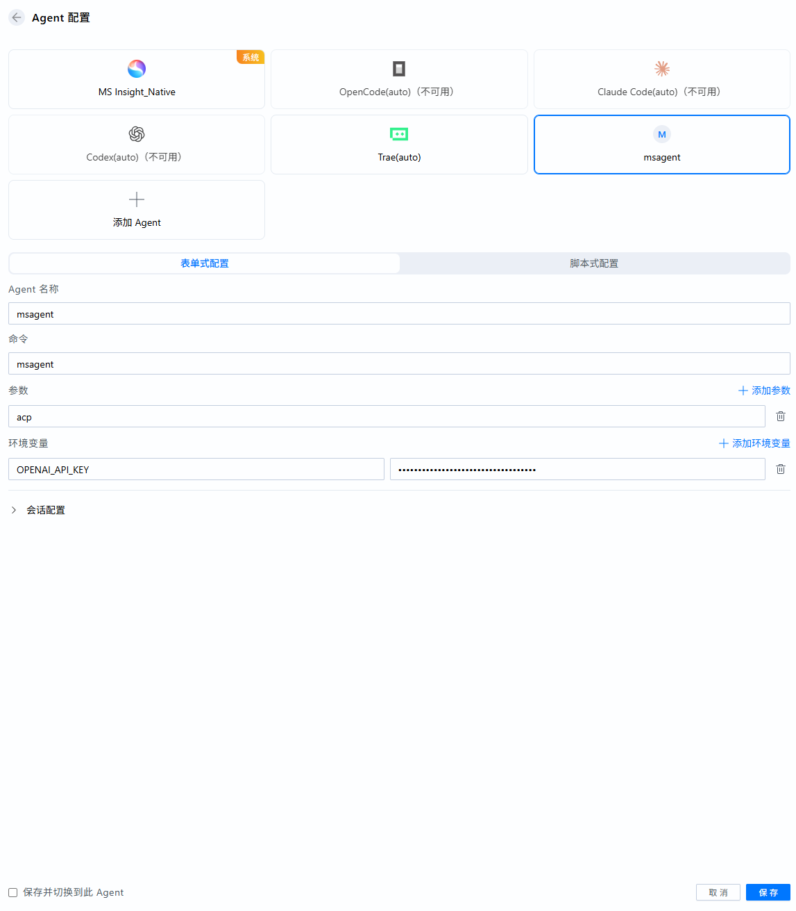

# 在 MindStudio Insight 2.0 中接入 msAgent（beta）

msAgent 提供 ACP（Agent Client Protocol）服务端；MindStudio Insight 2.0 作为客户端把 msAgent 添加为 Agent 后端后，即可在 MindStudio Insight 2.0 中直接使用 Profiler、Accuracy 等领域的 Agent，不需要另外打开终端。

## 前置条件

接入前需要完成三件事：安装 MindStudio Insight 2.0、安装 msAgent、配置模型。下文以 DeepSeek 为例，Key 可在 DeepSeek 开放平台创建。

MindStudio Insight 2.0 与 msAgent 必须安装在同一台机器上：Insight 会在本机启动 msAgent 子进程，不支持两者分开部署到不同环境。

### 安装 MindStudio Insight 2.0

仅支持 MindStudio Insight 2.0 及以上版本，低版本不支持 ACP 接入。安装方法见 [MindStudio Insight 2.0](https://msinsight2.codeasier.top/)。

### 安装 msAgent

安装方法见《[msAgent 安装指南](../install_guide/msagent_install_guide.md)》，推荐使用 uv 隔离安装（一键安装即属此类）。请安装最新版本的 msAgent。

### 配置模型

建议先完成模型配置，再添加 Agent。两种方式任选其一。

#### 方式一：`msagent config` 命令（单模型）

```bash
msagent config --llm-provider openai --llm-model deepseek-v4-flash --llm-base-url https://api.deepseek.com/v1
```

该命令会**整文件覆盖** `config.llms.yml`，因此 MindStudio Insight 2.0 下拉里只会显示这一个模型。执行完成后可用 `msagent config --show` 查看当前配置。其他配置方式详见《[msAgent 快速入门](../quick_start/msagent_quick_start.md)》中的"配置 LLM"一节。

#### 方式二：手动编辑配置文件（多模型）

需要在 MindStudio Insight 2.0 下拉里切换多个模型时，按下述步骤操作。

**1. 找到配置文件**

这是 msAgent 的用户级配置目录，由用户主目录（Windows 的 `%USERPROFILE%`，Linux / macOS 的 `$HOME`）决定，**与安装方式无关**：uv tool、pip、源码编译安装都是同一条路径，配置不会放在安装目录里。如果设置了 `MSAGENT_HOME` 环境变量，路径中的 `~/.msagent` 替换为该变量的值。

Windows：

```
C:\Users\<你的用户名>\.msagent\config\config.llms.yml
```

也可以在文件资源管理器地址栏输入 `%USERPROFILE%\.msagent\config` 直接打开该目录。

Linux / macOS：

```
~/.msagent/config/config.llms.yml
```

文件或目录不存在时自己创建。

**2. 写入模型**

下面以接入 DeepSeek 的两个模型为例（仅作示例，可替换为其他 OpenAI 兼容模型）：

| 别名（alias） | 模型（model） | 用途 |
| --- | --- | --- |
| `default` | `deepseek-v4-pro` | 默认模型，未显式指定模型时使用 |
| `flash` | `deepseek-v4-flash` | 需要更快响应时切换 |

把下面整段内容复制进配置文件：

```yaml
llms:
  - version: 26.1.3
    provider: openai
    alias: default
    model: deepseek-v4-pro
    api_key_env: OPENAI_API_KEY
    base_url: https://api.deepseek.com/v1
    max_tokens: 0
    temperature: 0.7
    streaming: true
    request_timeout_seconds: 300.0
    context_window: 128000

  - version: 26.1.3
    provider: openai
    alias: flash
    model: deepseek-v4-flash
    api_key_env: OPENAI_API_KEY
    base_url: https://api.deepseek.com/v1
    max_tokens: 0
    temperature: 0.7
    streaming: true
    request_timeout_seconds: 300.0
    context_window: 128000
```

字段说明：

| 字段 | 说明 |
| --- | --- |
| `alias` | 模型别名，必须唯一 |
| `model` | 服务端实际模型名，也是下拉里展示的名字 |
| `provider` | `openai` / `anthropic` / `google`（`gemini` 视为 `google`） |
| `api_key_env` | 从哪个环境变量读取 Key，需与添加 Agent 时填写的环境变量名一致；省略时用 provider 默认变量（`OPENAI_API_KEY` / `ANTHROPIC_API_KEY` / `GOOGLE_API_KEY`） |
| `base_url` | 兼容服务或代理地址，使用官方端点时可省略 |
| `context_window` | 上下文窗口，自动压缩阈值按它计算 |
| `version` | 配置格式版本，默认等于当前 msAgent 版本；一般照抄当前版本即可，写旧版本号会触发迁移 |

注意：所有配置里**必须有一个 `alias: default`**。

#### 两种方式的区别

| | `msagent config` | 手动编辑 |
| --- | --- | --- |
| 模型数量 | 只能保留 1 个（alias 固定 `default`） | 任意多个 |
| 写入方式 | 整文件覆盖 | 自己控制 |
| 适用场景 | 快速配置单一模型 | 需要下拉切换多个模型 |

## 添加 Agent

Insight 2.0 的添加 Agent 页面提供两种配置方式，任选其一。

### 方式一：表单式配置



| 字段 | 填写内容 |
| --- | --- |
| 名称 | `msagent` |
| 命令 | `msagent` |
| 参数 | `acp` |
| 环境变量 | 至少填一个模型服务的 Key：`OPENAI_API_KEY`、`ANTHROPIC_API_KEY` 或 `GOOGLE_API_KEY`，值替换成你自己的 Key；配置了几家模型就填几个 |

参数只需要填 `acp`。如需指定 Agent，写法与 msAgent 命令行一致，例如 `acp -a Profiler`，参数说明见《[msAgent 使用指南](usemap.md)》。

### 方式二：脚本式配置

在 Insight 2.0 添加 Agent 页面的脚本式配置输入框中直接粘贴以下 JSON（`******` 替换成你自己的 Key），不需要创建或保存 JSON 文件。

```json
{
  "command": "msagent",
  "args": [
    "acp"
  ],
  "env": {
    "OPENAI_API_KEY": "******"
  }
}
```

使用多家厂商时，`env` 里可以同时写多个 Key，对应厂商的模型会一起出现在下拉里：

```json
{
  "command": "msagent",
  "args": [
    "acp",
    "-a", "Profiler"
  ],
  "env": {
    "OPENAI_API_KEY": "******",
    "ANTHROPIC_API_KEY": "******"
  }
}
```

说明：

- 环境变量可以有多个，与 yaml 中各模型的 `api_key_env` 对应即可；没有 Key 的模型不会出现在下拉里
- `env` 中的变量只对 msAgent 子进程生效，不影响系统环境；也可以不写 `env`，改为提前在系统中设置好同名环境变量
- 如需指定模型，填模型别名（alias），不是模型名（`model` 字段）
