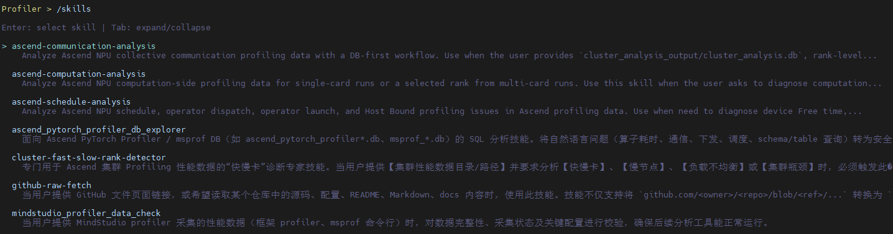
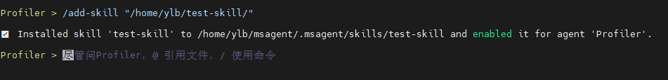

# MindStudio Agent Skills

## 1. Skill Specification

This repository follows the general conventions of Agent Skills. The goal is to ensure that skills are reusable, portable, and interoperable across different agents.

### 1.1 Directory Structure

Each skill adopts a flat and self-contained directory structure:

```text
skill-name/
├── SKILL.md       # Required: skill definition and description
├── references/    # Optional: reference materials
├── scripts/       # Optional: helper scripts
└── assets/        # Optional: templates and resources
```

### 1.2 `SKILL.md` Specification

Each skill must include `SKILL.md` with YAML frontmatter followed by Markdown content:

```md
---
name: skill-name
description: A detailed description of the skill, explaining what it does and when to use it.
---
```

Follow these principles:

- Use lowercase letters, numbers, and hyphens for `name`
- Specify both "what it does" and "when to use it" in `description`
- Place repeatable deterministic logic in `scripts/`
- Place lengthy background materials and detailed explanations in `references/`
- Place static resources such as templates, diagrams, and data files in `assets/`

## 2. Skill Index Directory

### 2.1 Performance Skills

| Skill | Purpose | Example Prompt |
| --- | --- | --- |
| `ascend-profiler-collect-adaption` | Adapt the `torch_npu.profiler` collection interface for training, inference, and reinforcement learning scenarios | `Help me integrate torch_npu.profiler into this training framework` |
| `ascend-profiler-data-validation` | Check whether profiling data is complete and analyzable | `Help me check whether this profiler directory can proceed to the next analysis step` |
| `ascend-profiler-db-explorer` | Analyze the Ascend profiler database | `Check the TopK operators and communication time consumption in this database` |
| `ascend-cluster-fast-slow-rank-detector` | Perform fast and slow rank analysis for clusters | `Analyze the causes of fast and slow ranks in this cluster profiling directory` |
| `ascend-msprof-analyze-cli` | Perform comprehensive Ascend performance analysis | `Use msprof-analyze to check this performance bottleneck` |
| `ascend-computation-analysis` | Analyze computation-side bottlenecks | `Check the computation hotspots and fusion opportunities of this rank` |
| `ascend-communication-analysis` | Analyze communication-side bottlenecks | `Check the communication time consumption and slow ranks in this cluster` |
| `ascend-schedule-analysis` | Analyze scheduling, dispatch, and Host Bound issues | `Identify the dispatch latency and scheduling bottlenecks` |
| `mindstudio-cpu-binding` | Analyze CPU binding, NUMA, and Host-side bottlenecks | `Troubleshoot the CPU binding issue of this multi-card task` |
| `memory-analysis` | This skill covers the full-link memory data flow: it guides msMemScope collection according to requirements, and systematically interprets dumps for leak/OOM/tuning diagnosis | `Help me collect the memory data during the backward process` / `Help me interpret this memory data and analyze the memory bottleneck` |
| `op-mfu-calculator` | Calculate operator MFU | `Calculate MFU based on this shape and time consumption` |
| `op-mfu-profiler` | Collect profiling data and parse operator MFU | `This is my program. Help me analyze the MFU of operators` |
| `ascend-cluster-compare` | Compare profiling data of two clusters, locate performance differences, and output a degradation attribution report | `Compare the performance data of these two clusters and analyze the causes of degradation` |
| `ascend-prof-compare` | Compare two Prof datasets (GPU vs NPU / NPU vs NPU), and generate an HTML comparison analysis report | `Compare the performance differences of these two prof datasets before and after optimization` |
| `msagent-profiler-breakdown` | One-step scenario-based breakdown: scenario confirmation → phase attribution + single execution boundary → report (extensible for inference/training/RL according to scenario resource file rules) | `Help me break down the phases and steps of this profiling data by layer` |

### 2.2 Precision Skills

| Skill | Purpose | Example Prompt |
| --- | --- | --- |
| `nan-overflow-detection` | Locate the source of NaN / overflow / gnorm anomalies | `Help me find the rank and operator where overflow first occurs` |
| `deterministic-calculation-analysis` | Analyze deterministic calculation issues | `Compare this batch of msProbe data and find the first inconsistent API` |
| `spike-root-cause-analysis` | Root cause analysis of Gradient Spikes | `What is the root cause of this spike data` |
| `compare-result-analyzer` | Analyze loss misalignment issues based on comparison results | `Analyze the comparison results` |
| `train-infer-op-diff-scanner` | RL train-infer operator difference scanning (fused operators vs single operators) | `Scan the operator differences between training and inference in this RL script` |
| `rl-consistency-analysis` | Perform root cause analysis of training and inference consistency | `Analyze the root cause of this training and inference inconsistency` |
| `precision-debugger` | Analyze and locate inference precision issues such as garbled output and repeated output | `I encountered an inference precision issue` |

### 2.3 Quantization Skills

| Skill | Purpose | Example Prompt |
| --- | --- | --- |
| `quantization-accuracy-tuning-orchestrator` | Automated quantization and precision tuning | `Help me run a round of automated quantization and precision tuning` |
| `quant-tuning-quantize` | Execute quantization | `Perform quantization according to this Practice YAML` |
| `quant-tuning-evaluate` | Execute quantized model evaluation | `Run the evaluation on the quantized model` |
| `tune-practice-cfg` | Generate or modify Practice YAML | `Help me generate the YAML for this tuning round` |
| `msmodelslim-quick-quant` | Quick quantization getting started | `Give me a minimal quantization solution` |
| `msmodelslim-layer-wise-quantization` | Layer-wise quantization | `The model memory is insufficient. Switch to layer-wise quantization` |
| `msmodelslim-model-dequant` | Dequantization integration | `Add dequantization capability to this FP8 model` |
| `msmodelslim-model-analysis` | Pre-quantization model analysis | `First analyze whether this model is suitable for adaptation` |
| `msmodelslim-model-adapt` | Model adaptation | `Help me implement the adaptation for this model` |
| `msmodelslim-adapter-verification` | Adapter verification | `Verify whether this adapter is usable` |
| `msmodelslim-anti-outlier-adapt` | Outlier suppression adaptation | `Use msModelSlim to extract the DOT graph and verify the default outlier suppression algorithm` |
| `gen-evaluation-cfg` | Generate evaluation configuration | `Generate an evaluation YAML` |

### 2.4 Operator Skills

| Skill | Purpose | Example Prompt |
| --- | --- | --- |
| `msot-msopprof-operator-profiler` | Perform msprof op operator analysis | `Output the bottleneck and optimization suggestions of this operator` |
| `ops-performance-tuning` | Perform compilation, profiling, and performance tuning for AscendC/CATLASS/Triton/TileLang/PyPTO/SHMEM operators | `Perform performance analysis on this operator and provide a before-and-after comparison report` |
| `mssanitizer-basic-usage` | Detect, analyze, and fix Ascend operator memory, race condition, initialization, and synchronization anomalies. Supports various Ascend official operator libraries and custom operators | `Detect whether this operator has anomalies` |
| `msdebug-basic-usage` | Ascend operator debugging and coredump analysis | `Debug this operator and analyze the coredump` |
| `mstx-report-soft-sync` | Analyze custom soft synchronization semantics in operators (inter-core barrier/set-wait, inter-card barrier/signal). Integrate the mssanitizer Sanitizer interface for reporting to avoid false positives from racecheck on soft synchronization | `Identify the soft synchronization in this operator and integrate mstx reporting` |

### 2.5 Document Review Skills

| Skill | Purpose | Example Prompt |
| --- | --- | --- |
| `document-ux-review` | Run through the README and review document usability | `Run through this repository's documentation and see whether a beginner can complete the process` |
| `gitcode-code-reviewer` | Review GitCode PRs | `Review this PR and point out issues` |
| `github-raw-fetch` | Fetch GitHub files or docs | `Convert this GitHub documentation page into readable content` |

### 2.6 Speculative Decoding Resampling Skills

> The `scripts/` of the skills are orchestrated based on the script interface of the open-source speculators repository ([vllm-project/speculators](https://github.com/vllm-project/speculators)) **v0.6.0**. It only performs parameter assembly and invocation; it does not modify the upstream speculators source code.

| Skill | Purpose | Example Prompt |
| --- | --- | --- |
| `speculators-response-regen` | On-policy resampling (response regeneration): DFX pre-check → input normalization → call the response_regeneration in the repository to regenerate assistant responses round by round using a verifier. Output pre-tokenized samples that can directly enter training (input_ids/loss_mask per line) | `Resample this dataset with this model` |

## 3. Skill Usage

When a user enters a task in a conversation, the Agent automatically matches and triggers the corresponding skill based on the intent of the prompt.
If you already know which skill to use, you can also manually load a specified skill through the `/skills` command.

| Command | Description |
| --- | --- |
| `/skills` | Open an interactive Skill list. Use the up and down arrows to browse, and press Enter to load. |
| `/skills <skill-name>` | Directly specify a Skill name to load, for example `/skills ascend-computation-analysis`. |
| `/skills <skill-name> <prompt>` | Load a Skill and pass in a task for execution, for example `/skills ascend-computation-analysis Help me analyze whether there are computation-related bottlenecks based on the performance data`. |



## 4. Custom Skill Addition

In addition to built-in skills, after entering the `msagent` interactive interface, users can install custom skills from a local path through `/add-skill` to meet personalized scenario requirements. Support specifying a Skill directory or `SKILL.md` file. Changes take effect immediately after installation.

| Command | Description |
| --- | --- |
| `/add-skill <path>` | Install a Skill directory from a local path. |
| `/add-skill <path>` | You can also directly specify the path of the `SKILL.md` file. |



## 5. Install Skills to Other Agents

Install Skills according to the method supported by the target Agent.

### 5.1 Method One: Use the `npx skills` Management Tool

Suitable for Agents that have integrated the `npx skills` workflow. If the target Agent does not support this tool, use the "manual copy" method below.

```bash
git clone https://gitcode.com/Ascend/msagent.git
cd msagent/skills

# View which skills are included in the current repository
npx skills add . --list

# Install one or more specified Skills
npx skills add . --skill ascend-communication-analysis --skill ascend-computation-analysis

# Install Skills to specific Agents (for example, trae and opencode)
npx skills add . -a trae -a opencode

# Install all Skills in the repository to all Agents
npx skills add . --all

# Install all Skills in the repository to multiple specified Agents
npx skills add . --skill '*' -a trae -a opencode
```

### 5.2 Method Two: Manually Copy the Skill Directory

This method is suitable for Agents that support scanning local skills directories. Before installation, confirm the skills directory convention of the target Agent.

```bash
git clone https://gitcode.com/Ascend/msagent.git
cd msagent/

# opencode
cp -r skills/profiler/ascend-profiler-db-explorer ~/.config/opencode/skills/

# claude
cp -r skills/profiler/ascend-profiler-db-explorer ~/.claude/skills/

# codex
cp -r skills/profiler/ascend-profiler-db-explorer ~/.codex/skills/
```
