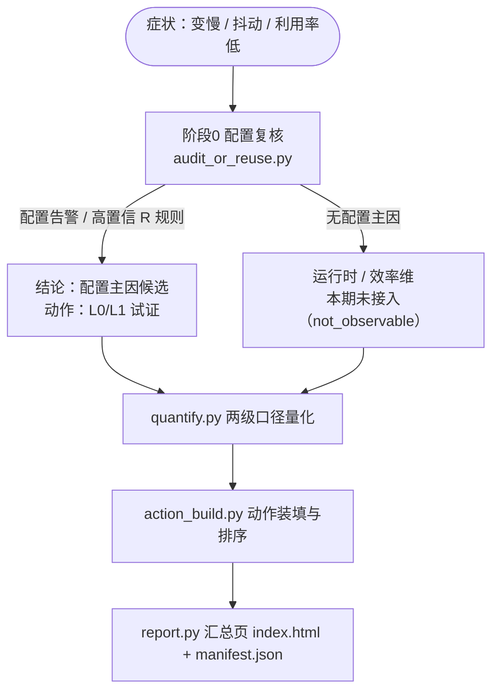

# msagent-perf-cpu-perf-triage — 性能异常归因编排

回答「训练慢 / step 抖动 / 利用率低的根因在哪」：把 host 侧异常归因到
**配置 / 系统打扰 / 等待 / 代码效率** 四类，并给出量化占比与可执行动作。

本期交付**配置维（判型 + 影响面）与动作编排**；打扰 / 等待两维依赖运行时采集，
随 tracing 技能合入后启用（`quantify.py` 已兼容其产物格式，无需改代码）。

本 Skill 是**唯一编排者**：本身不带 discover / topology，不重实现基础 Skill 的
采集与判定，全部通过子进程调用其 CLI 并消费结构化产物。

## 职责边界

- **做**：阶段调度、跨源归因、两级口径量化、Action 排序、汇总页与索引；
- **不做**：精确绑核方案（→ bind-tune）、配置判定阈值（→ config-audit）、
  运行时事件域采集与事实计算（后续版本接入）、PMU 效率定量（→ perf-collect，第二期）、
  代码改写（只给建议，交开发）。

## 流程



执行顺序固定：**配置优先（成本最低、即时可回滚）→ 运行时打扰/等待（后续接入）→
效率（第二期）**，不得跳阶段（降级矩阵允许的除外）。

## 命令行用法

所有脚本在 `scripts/`，统一 `python3 <script> --session <dir> ...`，stdout 输出 JSON。

### 0) 会话目录

会话根由首个子命令自动建立（`workspaces/<host>/<yyyymmdd-hhmmss>/`），也可显式传
`--session /path/to/session` 复用已有会话。本期创建 `00-config/` `02-perf/` `actions/`，
汇总页与 `manifest.json` 在根。运行时产物目录 `01-trace/` 由后续 tracing 技能产出，
`quantify.py` 检测到后会自动消费。

### 1) 阶段0 配置复核

```bash
python3 scripts/audit_or_reuse.py --session <S> [--findings <f.json>] \
    [--max-age-min 30] [--config-audit-dir <skill_dir>] [--skip-audit]
```

- 候选 findings 在 30min 内 → `REUSED`（直接消费，不重复审计）；
- 缺失或过期 → 子进程调 config-audit 快检 → `RERUN`；
- 找不到 config-audit → `UNAVAILABLE`（配置维缺失，进降级）。

产出 `00-config/config_triage.json`：判型结论（`config_primary_candidate` /
`impact_level`）+ 引用 Finding 与 Action 原文（不重判定）。

### 2) 量化 + 动作 + 汇总

```bash
python3 scripts/quantify.py     --session <S>
python3 scripts/action_build.py --session <S>
python3 scripts/report.py       --session <S>
```

产出：
- `attribution.json`（`AttributionResult`：config_typing / disturb_pct / wait_pct +
  wait_breakdown / efficiency / residual_pct / converged）
- `actions/action_plan.json`（Action[] 8 字段 + 编排层扩展）
- `index.html`（汇总页）+ `manifest.json`（机读索引）

## 产物组织

```
workspaces/<host>/<ts>/
├── index.html                  # 汇总页（唯一入口，只导航不合并内容）
├── manifest.json               # 机读索引：run_id / 阶段状态 / 产物路径 / 结论
├── attribution.json            # 归因量化结果
├── 00-config/
│   ├── config_triage.json
│   ├── findings.json           # config-audit 产物（复用或重跑）
│   └── hostcpu_config_report_<host>_<ts>.html
├── 02-perf/                    # 第二期（perf-collect 交付后）
└── actions/
    └── action_plan.json
```

> 运行时数据（可选）：若后续 tracing 接入并在会话内产出
> `01-trace/phase_verdict_1.json`，`quantify.py` 会自动读取并量化打扰 / 等待两维。

## 量化口径（简述，细则见 `references/quant-rules.md`)

| 维度 | 本期状态 | 口径 |
| ---- | ---- | ---- |
| 配置类 | 可用 | 判型定性排除（影响面 高/中/低，不硬折算数值） |
| 打扰类 | 未接入 | 运行时数据（`01-trace/phase_verdict_1.json`）合入后启用；缺数据记 `null` |
| 等待类 | 未接入 | 同上，按唤醒源细分（标 inference） |
| 效率类 | `not_observable` | 第二期 perf-collect 启用 |
| 残余 | 随运行时数据 | 运行时可归因时 `100% − 已归因`，> 30% 标「未收敛」；无数据记 `null` |

动作映射模板（运行时 `action_hint` → Action、等待唤醒源 → Action）以
`resources/action-templates.json` 为**唯一来源**，`scripts/action_build.py` 只查表；
调整动作文案改该 JSON 即可，不在代码或 references 中重复维护。

## 降级

见 `references/degradation.md`。核心几条：
- 无 config-audit → 配置维缺失，结论为「无法归因」，需补齐依赖后重跑；
- 运行时数据缺失（本期默认）→ 打扰/等待为 `null`，结论降级为「仅完成配置判型」；
- 运行时产物缺 `accounting`（版本不匹配）→ 两维按不可观测处理并显式标注。

## 与其他 Skill 的协作

| 上游 | 消费方式 |
| ---- | ---- |
| config-audit | 子进程调 `audit.py`（快检）或复用其 `findings.json`；产出只引用不重判 |

| 下游 | 转出方式 |
| ---- | ---- |
| bind-tune | Action 标 `bind_tune_handoff` + `suggested_cpuset`，由主会话转出出 plan |
| config-audit | 中断亲和类动作标 `config_audit_handoff`，转出生成命令 |
| Profiler / 通信域 | Host 侧无法直接消除的阻塞类问题，只给建议 + 转出引导 |

## 执行协议

本 Skill 只产出动作契约（含命令、回滚、验证），**不自动执行**。
高风险动作逐条展示「动作 / 影响 / 风险 / 回滚」后由用户确认（L0 可代执行试证，
L1/L2 出命令，L3 交运维），执行后复采同窗验证。
