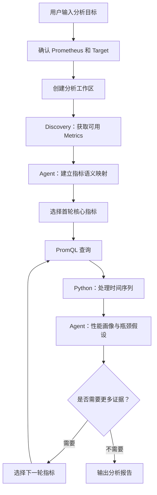

# Prometheus Runtime Metrics Analyzer

本 Skill 用于分析推理服务在指定历史时间区间内的运行状态，识别性能异常并分析可能原因。

支持 SGLang、vLLM 和 vLLM-Ascend。**只使用推理引擎原生 Prometheus Metrics**，不接入 MS Service Metric、自定义 Exporter 或 Grafana API。

## 职责划分

| 角色   | 职责                                                                                              |
|--------|---------------------------------------------------------------------------------------------------|
| Agent  | 理解分析目标；发现并理解可用指标；建立语义映射；构造 PromQL；分析异常、提出假设并决定是否补充查询 |
| Python | 提供 Prometheus API 访问、时间序列通用处理、查询结果持久化和分析文件管理                          |

指标选择、PromQL 构造和瓶颈判断由 Agent 决策，不固化在 Python 脚本中。

## 1. 分析目标与关注指标

### 1.1 核心指标维度

分析时优先从以下维度理解服务状态。实际可用指标以 Discovery 结果为准。

| 维度           | 关注指标                                                                 | 主要反映的问题                                   |
|----------------|--------------------------------------------------------------------------|--------------------------------------------------|
| **Latency**    | TTFT、TPOT、ITL、Queue Time、Prefill / Decode Time                       | 请求延迟，以及 Prefill、排队和 Decode 阶段的表现 |
| **Throughput** | Prompt Token Throughput、Generation Token Throughput、Request Throughput | 服务处理能力和单位时间内完成的工作量             |
| **Scheduler**  | Running Requests、Waiting Requests、Preemption                           | 请求排队、并发调度和资源竞争情况                 |
| **KV Cache**   | KV Cache Usage、Prefix Cache Hit Rate                                    | 缓存资源使用情况和缓存命中行为                   |
| **Workload**   | 请求数量、Prompt Tokens、Generation Tokens                               | 请求规模、输入输出长度及负载变化                 |

这些是分析语义维度，不是固定指标清单。不同引擎、版本和部署配置暴露的指标可能不同。

### 1.2 常见瓶颈方向

下表用于形成初步分析方向，不能仅凭单个指标直接确认瓶颈。

| 瓶颈方向            | 典型表现                                           | 后续关注方向                                 |
|---------------------|----------------------------------------------------|----------------------------------------------|
| **请求排队 / 调度** | Waiting Requests 或 Queue Time 增加，TTFT 恶化     | Running、Waiting、Queue Time、请求负载       |
| **Prefill 性能**    | TTFT 上升，且 Prefill Time 可能同步增加            | TTFT、Prefill Time、Prompt Tokens            |
| **Decode 性能**     | TPOT / ITL 上升，Generation Throughput 下降        | TPOT、ITL、Decode Time、生成长度             |
| **KV Cache 压力**   | Cache Usage 较高，并伴随 Preemption 或缓存命中异常 | Cache Usage、Preemption、Prefix Cache        |
| **服务吞吐受限**    | 请求持续增加，但处理吞吐增长有限，等待请求积累     | Running、Waiting、Token Throughput、Workload |

分析时还需考虑并发、输入长度、输出长度、请求速率等 Workload 变化。负载变化本身可能解释部分性能变化，不应直接归因为引擎瓶颈。

### 1.3 SGLang / vLLM 常见指标参考

以下为常见指标名称示例，用于帮助 Agent 建立初始语义映射。**不保证所有版本或部署配置均暴露这些指标，实际查询必须以 Discovery 结果为准。**

| 分析语义              | vLLM / vLLM-Ascend 示例                      | SGLang 示例                                    |
|-----------------------|----------------------------------------------|------------------------------------------------|
| TTFT                  | `vllm:time_to_first_token_seconds`           | `sglang:time_to_first_token_seconds`           |
| TPOT                  | `vllm:request_time_per_output_token_seconds` | `sglang:request_time_per_output_token_seconds` |
| ITL                   | `vllm:inter_token_latency_seconds`           | `sglang:inter_token_latency_seconds`           |
| Queue Time            | `vllm:request_queue_time_seconds`            | `sglang:queue_time_seconds`                    |
| Running Requests      | `vllm:num_requests_running`                  | `sglang:num_running_reqs`                      |
| Waiting Requests      | `vllm:num_requests_waiting`                  | `sglang:num_queue_reqs`                        |
| Generation Throughput | `vllm:generation_tokens`（Counter）          | `sglang:gen_throughput`（Gauge）               |
| KV Cache Usage        | `vllm:kv_cache_usage_perc`                   | `sglang:token_usage`                           |

注意：

- vLLM-Ascend 以实际部署版本的 Metadata 为准，不假设与上游 vLLM 完全一致。
- SGLang 的 `token_usage` 不应直接视为与 vLLM KV Cache Usage 完全等价；混合缓存模型还可能暴露 `full_token_usage`、`swa_token_usage`、`mamba_usage` 等指标。
- TPOT 和 ITL 相关但不完全相同，应结合 HELP 和实际统计口径判断。
- Counter、Gauge、Histogram 的查询方式不同，不能只根据指标名称构造 PromQL。

参考文档：

- [vLLM Production Metrics](https://docs.vllm.ai/en/latest/usage/metrics/)
- [SGLang Production Metrics](https://github.com/sgl-project/sgl-project.github.io/blob/main/markdown/references/production_metrics.md)

## 2. 输入与环境准备

### 2.1 分析输入

分析任务需要明确以下信息：

| 字段               | 必需性 | 说明                                                                            |
|--------------------|--------|---------------------------------------------------------------------------------|
| `prometheus_url`   | 必填   | Prometheus 服务地址                                                             |
| `target`           | 必填   | 需要分析的单个服务 Target，使用实际存在的 Labels 定位，通常为 `job`、`instance` |
| `start`            | 必填   | 分析开始时间                                                                    |
| `end`              | 必填   | 分析结束时间                                                                    |
| `step`             | 可选   | Query Range 采样间隔，单位为秒                                                  |
| `engine`           | 可选   | 引擎类型，如 `sglang`、`vllm`、`vllm-ascend`                                    |
| `symptom`          | 可选   | 用户观察到的异常，如 TTFT 上升                                                  |
| `reference_window` | 可选   | 用于对比的参考时间区间                                                          |
| `slo`              | 可选   | TTFT、TPOT 等服务目标或告警阈值                                                 |

输入格式和字段结构参考 `config/request-input.example.json`。填写实际信息后保存为 `request-input.json`。

时间必须明确时区，支持带时区的 RFC3339 格式或 Unix 时间戳。用户提供当地时间时，转换为带时区的 RFC3339；存在歧义时先向用户确认。

认证信息仅从环境变量 `PROMETHEUS_BEARER_TOKEN` 读取，不得写入输入文件、URL、PromQL 或 Labels。

一次分析绑定一个 Prometheus 和一个 Target。跨服务分析时分别创建分析工作区，不在同一个任务中混合不同服务的数据。

### 2.2 确认 Prometheus Target

如果用户已提供 Prometheus URL 和精确 Target，可以直接使用。

如果 Target 不明确，先查询当前 Prometheus 的 Active Targets：

```bash
python3 scripts/prometheus_client.py targets \
  --url http://npu-server-a:9090
```

根据实际 Labels 选择与分析目标一致的服务；存在多个匹配项时先确认，不要随意选择。

`targets` 只反映当前 Active Targets。历史服务已经停止或从抓取配置移除时，可以使用用户提供的历史 Labels 继续分析，不要求 Target 当前处于 UP 状态。

## 3. 分析工作流

整体流程：



### 3.1 创建分析工作区

```bash
ANALYSIS_DIR=$(python3 scripts/run_manager.py create \
  --request request-input.json \
  --output outputs)
```

**目的：** 为本次分析创建独立工作区，固定 Prometheus URL、Target 和主分析时间区间，并提供统一的数据保存位置。

后续查询继承该上下文。原始响应、处理结果、指标映射、分析证据和最终报告均保存在工作区中。整个分析过程只创建一次；更换 Prometheus、Target 或主分析时间区间时，创建新的工作区。

典型目录结构：

```text
outputs/
└── metrics-analysis/
    └── analysis_<timestamp>_<id>/
        ├── request.json
        ├── manifest.json
        ├── metric_catalog.json
        ├── queries/
        │   └── round_01/
        │       └── query_001/
        │           ├── request.json
        │           ├── response.json.gz
        │           └── processed.json
        └── analysis/
            ├── metric_mapping.md
            ├── evidence.json
            └── report.md
```

实际目录和文件名以脚本实现为准；Agent 不需要手动创建或维护这些目录。

### 3.2 Discovery：了解有哪些指标

```bash
python3 scripts/prometheus_client.py discover \
  --analysis-dir "$ANALYSIS_DIR"
```

**目的：** 在查询指标前了解目标服务实际暴露了哪些 Metrics，避免根据经验猜测指标名称和类型。

Discovery 获取 Prometheus readiness、当前 Target 状态、Target-scoped Metrics Metadata，以及指定时间区间内的历史 Series。结果保存到：

```text
$ANALYSIS_DIR/metric_catalog.json
```

Agent 重点查看实际 Metric Name、TYPE、HELP、Unit 和 Labels，并确认以下状态：

| 字段                           | 含义                              |
|--------------------------------|-----------------------------------|
| `target_currently_up`          | 当前匹配的 Target 是否 UP         |
| `metadata_available`           | 是否获取到 Target-scoped Metadata |
| `historical_series_discovered` | 是否发现指定区间的历史序列        |
| `warnings`                     | Discovery 过程中的异常或限制      |

注意：

- Prometheus 未 Ready 时，先解决连接或服务问题。
- Target 当前 DOWN 不代表历史数据不可用，不能仅因此终止分析。
- 当前 Metadata 不一定代表历史时段运行的版本或模型。
- 历史 Series 只代表候选指标，不保证整个区间都有样本。
- 无法确认指标类型时标记为 `unknown`，不要根据名称或后缀猜测。
- 必要时查询历史 `up` 指标，辅助判断目标服务在分析区间内的抓取状态。

### 3.3 Agent 建立指标语义映射

**目的：** 将 Discovery 得到的实际指标与性能分析语义对应起来，为首轮查询和后续补充证据提供依据。

Agent 根据 `metric_catalog.json` 中的 Metric Name、TYPE、HELP、Unit 和 Labels，结合引擎信息及第 1.3 节的指标参考，识别与本次分析相关的指标。

映射示例：

| 分析语义              | 实际 Metric                | TYPE            | 备注                    |
|-----------------------|----------------------------|-----------------|-------------------------|
| TTFT                  | Discovery 中实际发现的指标 | Histogram       | 请求首 Token 延迟       |
| TPOT                  | Discovery 中实际发现的指标 | Histogram       | 请求级输出 Token 延迟   |
| Running Requests      | Discovery 中实际发现的指标 | Gauge           | 正在运行的请求数        |
| Generation Throughput | Discovery 中实际发现的指标 | Gauge / Counter | 生成吞吐或 Token 累计量 |

映射时注意：

- 只映射本次分析相关的指标，不要求覆盖整个 Catalog。
- 相同语义可能对应不同统计口径，应结合 HELP 判断。
- 不同引擎的相似指标不一定完全等价。
- 保留有意义的 Model、Rank、Instance 等 Labels，后续查询时避免误聚合。
- 找不到对应指标时标记为 `unavailable`，不要猜测替代项。

将本次分析的指标映射保存到：

```text
$ANALYSIS_DIR/analysis/metric_mapping.md
```

映射由 Agent 动态生成。Python 不维护 SGLang / vLLM 专属指标名称或适配规则。

### 3.4 选择首轮核心指标

**目的：** 先通过少量指标建立整体性能画像，再根据初步结果决定是否深入，避免无差别拉取全部 Metrics。

| 分析场景                | 首轮查询思路                                                                     |
|-------------------------|----------------------------------------------------------------------------------|
| 用户未指定异常方向      | 从 Latency、Throughput、Scheduler、KV Cache 和 Workload 中选择实际可用的核心指标 |
| 用户明确指出异常        | 优先查询异常指标及其相关指标，不必机械覆盖所有维度                               |
| 用户提供 SLO 或告警阈值 | 优先查询与目标指标直接相关的数据，并判断是否违反 SLO                             |
| 用户提供参考时间区间    | 首轮查询当前区间；必要时使用相同表达式补充参考区间                               |

首轮指标应根据实际 Catalog 选择，不要求每类指标都存在，也不要求一次性查询全部指标。

### 3.5 构造 PromQL 并执行查询

**目的：** 根据实际指标类型和分析目标，将需要验证的问题转化为 PromQL，并获取指定时间区间内的时间序列。

根据 Discovery 得到的实际 TYPE 构造 PromQL：

| Metric TYPE | 常见查询方式                                     | 注意事项                                            |
|-------------|--------------------------------------------------|-----------------------------------------------------|
| Gauge       | 通常直接查询                                     | 关注时间趋势、峰值和变化                            |
| Counter     | `rate()` 或 `increase()`                         | 获取单位时间速率或区间增量，不直接把累计值当吞吐    |
| Histogram   | `histogram_quantile()`，或查询 `_sum` / `_count` | 确认实际指标族及 `_bucket`、`_sum`、`_count` 序列   |
| Summary     | 结合实际暴露的数据和 HELP 确定                   | 不假设所有 Summary 都能从原始序列重新计算任意分位数 |

经典 Histogram P95 示例：

```promql
histogram_quantile(
  0.95,
  sum by (le, model_name) (
    rate(<actual_metric_family>_bucket{
      job="...",
      instance="..."
    }[5m])
  )
)
```

指标名称、Labels、聚合维度和 Rate Window 必须根据实际 Catalog 调整。

查询时注意：

- 每个原始 Metric Selector 都必须包含当前工作区的精确 Target Labels。
- 聚合前考虑 Model、Rank、Instance 等维度，不能默认合并不同序列。
- 不要直接平均多个实例的延迟分位数。
- Rate Window 应考虑 Scrape Interval 和边界采样。
- 指标不可用或类型未知时，不要强行构造查询。
- 原生 Histogram 优先通过 PromQL 转换为数值；Processor 对未转换的原生 Histogram 样本只统计数量，不将其当作 0。

参考 `config/queries.example.json` 中的 Gauge、Counter Rate 和 Histogram P95 写法。该文件用于参考查询结构，示例中的指标名称和 Labels 不应直接执行。

将本轮查询保存为 JSON 数组，例如：

```text
$ANALYSIS_DIR/queries_round_01.json
```

每项查询包含实际 PromQL，可按需提供 `unit`、`start`、`end` 和 `step`。具体结构参考 `config/queries.example.json`。

执行本轮批量查询：

```bash
python3 scripts/prometheus_client.py query \
  --analysis-dir "$ANALYSIS_DIR" \
  --round 1 \
  --queries-file "$ANALYSIS_DIR/queries_round_01.json" \
  > "$ANALYSIS_DIR/queries_round_01_result.json"
```

每条查询自动分配 `query_id`，请求和原始响应自动落盘。处理成功项；失败项查看错误信息，不要因部分失败而重跑整个批次。后续查询使用新的查询文件并递增 `--round`。Round 只是查询批次标识，不代表固定诊断轮数。

### 3.6 Python 处理时间序列

**目的：** 将 Prometheus 返回的原始时间序列转换为便于 Agent 判断的统计特征和趋势信息。

对每条成功查询执行：

```bash
python3 scripts/metrics_processor.py \
  --analysis-dir "$ANALYSIS_DIR" \
  --query-id query_001 \
  --trend-window 60
```

Processor 按 Labels 独立处理时间序列，主要输出：

| 输出                 | 内容                                                                                          | 用途                     |
|----------------------|-----------------------------------------------------------------------------------------------|--------------------------|
| Data Quality         | 预期采样点、实际采样点、有效采样点、缺失比例、时间覆盖情况                                    | 判断数据是否足以支撑结论 |
| Statistics           | Mean、Median、Min、Max、Start、End、Delta、Relative Change、Slope、Peak Timestamp、Sample P95 | 识别异常幅度和趋势       |
| Trend                | 按时间窗口统计 Mean、Min、Max 和样本数量                                                      | 观察持续恶化、突增和恢复 |
| Reference Comparison | 与参考查询按 Labels 对齐后的统计比较                                                          | 判断相对基线是否退化     |

结果自动保存为对应查询目录下的 `processed.json`。Processor 只负责通用数据处理，不判断性能瓶颈。

数据处理注意事项：

- 按 Labels 独立处理，不默认合并不同时间序列。
- 缺失数据不能当作 0；NaN、Inf 不参与统计。
- 空结果标记为 `no_data`。
- `time_coverage` 是首末有效采样点的时间跨度占比，不代表内部没有缺口或底层 Scrape 完整。
- `sample_p95` 是时间序列采样值的 P95，不是请求延迟 P95。
- 不为无采样的时间窗口生成虚构零值。

### 3.7 Agent 分析并补充证据

**目的：** 根据本轮处理结果形成初步性能判断，并选择最有价值的下一组指标验证或排除假设。

Agent 阅读本轮 `processed.json`，结合指标语义、趋势、Labels 和数据质量，形成性能画像及初步假设。每轮分析应区分：

| 分析内容                | 含义                                 |
|-------------------------|--------------------------------------|
| **Observations**        | 实际观察到的指标变化、时间范围和数值 |
| **Hypotheses**          | 基于当前证据提出的可能原因           |
| **Supporting Evidence** | 支持某个假设的指标及其变化           |
| **Counter Evidence**    | 不支持或与假设矛盾的证据             |
| **Next Evidence**       | 下一轮最值得获取的指标及查询目的     |

例如：

| 当前观察                        | 可进一步验证的方向                                                 |
|---------------------------------|--------------------------------------------------------------------|
| TTFT 上升而 TPOT 相对稳定       | 检查 Queue Time、Waiting Requests 和 Prefill Time                  |
| TPOT / ITL 恶化而 TTFT 相对稳定 | 检查 Decode 相关指标及 Generation Throughput                       |
| KV Cache Usage 较高             | 结合 Preemption、Prefix Cache 等指标判断是否存在缓存压力           |
| Throughput 下降且 Waiting 增加  | 结合 Running、请求量和 Token Throughput 判断服务负载与处理能力变化 |

Agent 自主决定是否继续：

1.  假设需要验证时，选择能够支持或反驳它的指标，进入下一轮 Query → Processing → Analysis。
2.  证据充分或进一步查询没有明显价值时停止。
3.  相同 PromQL、时间区间和 step 已有成功响应时复用已保存结果（包括空结果）；失败查询允许在同一 Run 内重试，保留每次尝试及错误记录。
4.  不设置固定诊断轮数或查询数量。

需要参考区间对比时，使用相同 PromQL、Target 和查询粒度单独查询参考区间，再通过 `--reference-query-id` 处理。比较前判断两个区间的 Workload 是否可比。

每轮查询结果自动落盘。将重要观察、假设、查询 ID 和证据引用持续整理到：

```text
$ANALYSIS_DIR/analysis/evidence.json
```

## 4. 判断原则与输出报告

### 4.1 判断原则

- **不设置统一的 TTFT / TPOT 绝对异常阈值**，优先参考用户提供的 SLO 或告警阈值。
- 对比参考区间时，判断 Workload 是否可比；没有参考区间时，关注当前区间内的趋势、突增、持续恶化和恢复。
- 区分 **Performance Degradation** 与 **SLO Violation**。
- 指标相关性不代表因果关系；单独的 KV Cache Usage 高不能证明缓存是性能瓶颈。
- 结合数据质量判断结论可信度；证据不足时保留为可能原因，不将推测写成确定结论。

本 Skill 只分析性能异常及可能原因，不提供推理引擎参数优化建议。

### 4.2 输出分析报告

分析结束后，Agent 生成：

```text
$ANALYSIS_DIR/analysis/evidence.json
$ANALYSIS_DIR/analysis/report.md
```

报告至少包括：

| 章节                        | 内容                                      |
|-----------------------------|-------------------------------------------|
| **Analysis Scope**          | Prometheus、Target、引擎和分析时间范围    |
| **Summary**                 | 整体表现和主要异常                        |
| **Observations & Evidence** | 关键指标变化、查询 ID、Labels、时间和数值 |
| **Possible Causes**         | 可能原因及证据强弱                        |
| **Counter Evidence**        | 不支持当前假设的证据                      |
| **Limitations**             | 缺失指标、数据缺口、Workload 不可比等限制 |

完成后执行：

```bash
python3 scripts/run_manager.py finalize \
  --analysis-dir "$ANALYSIS_DIR" \
  --evidence "$ANALYSIS_DIR/analysis/evidence.json" \
  --report "$ANALYSIS_DIR/analysis/report.md"
```

该命令只保存最终证据和报告并更新工作区记录，不负责生成诊断结论。最终交付工作区路径及 `analysis/report.md`。

## 5. Prometheus 环境部署参考

Prometheus 和 Grafana 的部署、配置与排障不属于本 Skill 的主要分析流程。需要搭建监控环境或排查连接、抓取和历史数据问题时，按需阅读 `references/prometheus_setup.md`。

已有环境直接复用，不自动安装或启动服务。Prometheus 应独立于推理服务长期运行；vLLM / SGLang 停止、重启或切换时通常不需要重启 Prometheus。Target DOWN 不代表历史数据丢失。

Grafana 是可选展示组件。Metrics Analyzer 直接访问 Prometheus HTTP API，不依赖 Grafana。
