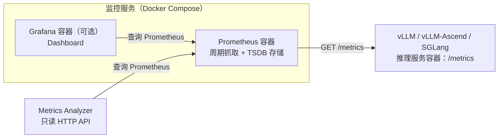

# Prometheus 监控环境准备

本文供操作者准备或检查推理服务的 Metrics 监控环境。**已有 Prometheus 时直接复用**，不必按本文重新部署。

**执行分析前必须明确 `prometheus_url`**，且该 URL 必须从 Agent 的实际运行环境可访问。若未提供，可依据用户明确指定的部署配置找到候选地址并请用户确认；不能直接猜测、扫描网络或自动部署服务。

## 1. 组件关系



- **推理服务**通常独立启动，提供原生 `/metrics`；本方案不要求额外的 Exporter 或 MS Service Metric。SGLang 启动时需启用 `--enable-metrics`；vLLM / vLLM-Ascend 应确认所用版本的 `/metrics` 实际可用。
- **Prometheus** 主动抓取推理服务并保存历史指标。`prometheus.yml` 决定抓取哪个地址、以多长间隔抓取。
- **Grafana（可选）** 查询 Prometheus 来展示看板；它不是 Analyzer 的依赖。
- **Metrics Analyzer** 查询 Prometheus 的 HTTP API，不直接读取 Grafana，也不控制监控服务。

这些组件可以部署在同一台宿主机的不同容器，也可以跨主机部署。必要的网络条件只有两个：**Prometheus 能访问推理服务的 `/metrics`；Analyzer 能访问 Prometheus HTTP API**。

## 2. 推理服务与 Docker 网络

先确认推理服务启动成功，且 `/metrics` 端点可访问。不要混淆三个地址：

- **推理服务监听地址**：例如 vLLM 的 `--host 0.0.0.0 --port 8000`，指定进程在自身网络空间监听哪个接口和端口。
- **容器内部地址和端口**：例如 `vllm-server:8000`，供同一自定义 Docker 网络中的其他容器访问。
- **宿主机地址和发布端口**：例如 Docker 参数 `-p 9000:8000` 表示从宿主机 `:9000` 转发到容器 `:8000`。

Prometheus 的 `targets` 要填写**从 Prometheus 容器内能访问到的地址和端口**：

| 推理服务部署方式 | `targets` 示例 | 说明 |
| --- | --- | --- |
| vLLM 使用宿主机网络（或已把容器端口发布到宿主机），Prometheus 使用同宿主机的 bridge 网络 | `host.docker.internal:8000` | Linux 下可用下文的 `host-gateway` 映射；若宿主机发布端口为 `9000`，应改填 `:9000` |
| vLLM 与 Prometheus 接入同一个自定义 Docker 网络 | `vllm-server:8000` | 使用容器名或网络别名及**容器内部端口**，通常不需要 `-p` |
| vLLM 位于另一台服务器 | `10.0.0.12:8000` | 使用 Prometheus 可达的远端地址及对应端口 |

下方示例采用第一种情况。注意：

- `host.docker.internal` 是 Prometheus 容器访问宿主机的**一种**方式，并不是任意容器部署都通用的地址。
- 推理服务仅监听其容器内的 `127.0.0.1` 时，其他容器通常不能访问它；`0.0.0.0` 用于**监听**，不是填写在 `targets` 中的目标 IP。
- 只把推理容器的端口发布到宿主机 `127.0.0.1`，也不代表可经 `host.docker.internal` 访问。应根据网络实际可达性调整。

## 3. 最小部署示例

在同一个准备目录创建 `compose.yaml` 和 `prometheus.yml`。以下示例只部署 Prometheus 和可选 Grafana，**不会启动推理服务**。

### 3.1 `compose.yaml`

```yaml
services:
  prometheus:
    image: prom/prometheus:latest
    ports:
      - "127.0.0.1:9090:9090"
    volumes:
      - ./prometheus.yml:/etc/prometheus/prometheus.yml:ro
      - prom-data:/prometheus
    extra_hosts:
      - "host.docker.internal:host-gateway"

  grafana:
    image: grafana/grafana:latest
    profiles: ["ui"]
    depends_on:
      - prometheus
    ports:
      - "127.0.0.1:3000:3000"
    volumes:
      - grafana-data:/var/lib/grafana

volumes:
  prom-data:
  grafana-data:
```

- `prom-data` 保留 Prometheus 的历史指标，避免容器重建时因存储未正确复用而丢失历史数据；`grafana-data` 保留 Grafana 的设置。 
- Prometheus 默认 TSDB 保留期通常为 **15 天**；需要更长时间时，再按部署版本配置 retention。
- `127.0.0.1:9090:9090` 与 `127.0.0.1:3000:3000` 只将端口发布到**宿主机本地**。若 Analyzer 运行在另一容器或另一台机器，不能直接照搬 `http://127.0.0.1:9090`，需要由操作者提供真实可达、经过访问控制保护的地址。

### 3.2 `prometheus.yml`

```yaml
global:
  scrape_interval: 15s

scrape_configs:
  - job_name: vllm
    metrics_path: /metrics
    static_configs:
      - targets: ["host.docker.internal:8000"]
```

- `targets` 决定实际抓取的服务地址；示例每 15 秒请求一次 `http://host.docker.internal:8000/metrics`。
- `job_name` 是采集任务名称，形成 `job="vllm"` 标签，**不负责发现服务**；`instance` 默认标识具体的抓取地址（如 `host.docker.internal:8000`）。
- 如果监控的是 SGLang 或其他端口，修改 `job_name` 和 `targets` 即可。

### 3.3 启动

```bash
docker compose up -d
```

打开宿主机上的 `http://127.0.0.1:9090` 检查 Prometheus。启用 Grafana 后，在 Grafana 中新增 Prometheus 数据源，URL 填写 `http://prometheus:9090`（Compose 内部使用服务名连接），然后执行 **Save & test**。Grafana 不需要配置为 Analyzer 的数据源。

## 4. 验证环境

以下命令在**可以访问该 Prometheus 地址的环境**中执行。`PROM` 只是验证示例；Agent 真正使用的 `prometheus_url` 还需在其运行环境中验证可达性。

```bash
PROM='http://127.0.0.1:9090'  # 根据实际情况修改

# 1) Prometheus 是否已就绪
curl --fail "$PROM/-/ready"

# 2) 当前采集目标的状态、标签和错误信息
curl --fail "$PROM/api/v1/targets?state=active"

# 3) 查询最近 10 分钟的采集情况（Linux/GNU date）
START=$(date -u -d '10 minutes ago' +%s)
END=$(date -u +%s)
curl --fail --get "$PROM/api/v1/query_range" \
  --data-urlencode 'query=up{job="vllm",instance="host.docker.internal:8000"}' \
  --data-urlencode "start=$START" \
  --data-urlencode "end=$END" \
  --data-urlencode 'step=15s'
```

验证时依次确认：

1. **推理服务**：实际 `/metrics` 返回指标；若在宿主机可访问但 Target DOWN，应优先检查 Prometheus 容器到推理服务的网络。
2. **当前采集**：在 `/api/v1/targets` 查看 `labels`、`scrapeUrl`、`health`、`lastError`。`health=up` 表示当前抓取健康。
3. **历史数据**：`query_range` 返回非空序列及有效采样点；`up=1` 表示对应时刻抓取成功，`up=0` 表示抓取失败。仅有 HTTP 200 或 `status=success` 不代表实际查到了数据。分析异常区间时，还应确认该区间内的**引擎原生指标**存在。

**注意：** 当前 Target DOWN 不代表历史数据不可分析。历史查询需使用事件发生时的准确时间范围，以及当时有效的 `job`、`instance` 和其他 Labels。

## 5. 常见问题与维护边界

| 现象 | 优先检查 |
| --- | --- |
| Analyzer 无法连接 Prometheus | `prometheus_url` 是否从 Agent 所在环境可达；是否误用容器内 `localhost`；端口、防火墙、TLS / 认证 |
| Target DOWN | `scrapeUrl`、`lastError`、推理服务监听地址、容器网络以及端口发布 |
| 历史查询为空 | 时间范围和时区、TSDB 保留期、原有 `job` / `instance` 标签、当时的 `up` 和引擎指标是否存在 |
| 推理服务地址或端口改变 | 修改 `prometheus.yml` 并重载或重启 Prometheus |


## 参考资料

- [vLLM 官方 Prometheus + Grafana 示例](https://docs.vllm.ai/en/latest/examples/observability/prometheus_grafana/)
- [vLLM Production Metrics](https://docs.vllm.ai/en/latest/usage/metrics/)
- [SGLang Observability](https://github.com/sgl-project/sglang/blob/main/docs/docs/advanced_features/observability.mdx)
- [Prometheus 配置](https://prometheus.io/docs/prometheus/latest/configuration/configuration/)
- [Prometheus HTTP API](https://prometheus.io/docs/prometheus/latest/querying/api/)
- [Prometheus 管理 API](https://prometheus.io/docs/prometheus/latest/management_api/)
- [Prometheus 存储与保留期](https://prometheus.io/docs/prometheus/latest/storage/)
- [Grafana Prometheus 数据源](https://grafana.com/docs/grafana/latest/datasources/prometheus/configure/)
